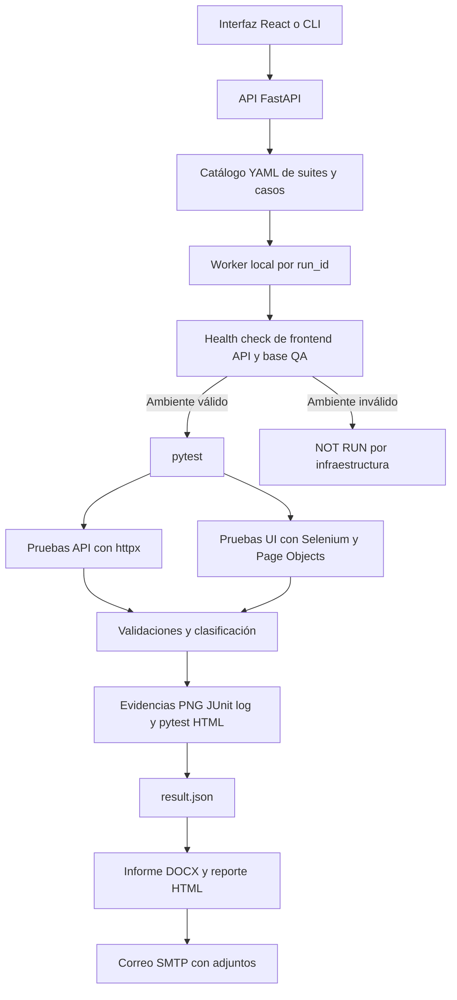

# 6.3 Pruebas Automatizadas

**Proyecto:** IPAS IUS PUNIENDI  
**Autor, implementador y ejecutor:** Tamengo Sanchez Bustamante Calderon  
**Periodo documentado:** 1 de julio al 17 de noviembre de 2026

La automatización se implementó en `qa-platform`, una plataforma separada de la aplicación probada IPAS. Esta separación permite ejecutar pruebas, conservar evidencias y generar reportes sin incorporar código de pruebas dentro del SUT. Al cierre del 17 de noviembre de 2026, los 15 casos funcionales seleccionados tenían scripts ejecutables; la suite estable obtuvo 14 PASS y el caso de permisos se mantuvo como FAIL controlado vinculado a BUG-01-F.

## 6.3.1 Objetivo

El objetivo fue automatizar los escenarios funcionales repetibles y de mayor prioridad de IPAS, incluyendo validaciones positivas, negativas, de límite, de roles y de recorrido completo. La plataforma debía comprobar primero el ambiente, ejecutar únicamente contra `ius_puniendi_qa`, clasificar los resultados, conservar evidencia por `run_id` y producir reportes trazables.

## 6.3.2 Alcance y Selección

La selección priorizó funciones críticas, resultados deterministas, datos ficticios controlables y escenarios que podían limpiarse después de la ejecución. Se excluyeron procesos con documentos jurídicos reales, servicios externos no necesarios y pruebas que pudieran modificar una base distinta de QA.

| ID | Funcionalidad | ¿Se automatiza? | Prioridad | Justificación | Herramienta |
|---|---|---|---|---|---|
| TC-SMK-001 | Disponibilidad integral | Sí | Alta | Bloquea ejecuciones sobre un ambiente incorrecto | pytest, httpx, psycopg |
| TC-LOG-001 | Login válido por interfaz | Sí | Alta | Flujo principal de acceso interno | Selenium, pytest |
| TC-LOG-002 | Contraseña incorrecta | Sí | Alta | Validación negativa determinista | httpx, pytest |
| TC-LOG-003 | Correo vacío | Sí | Alta | Límite inferior de un campo obligatorio | httpx, pytest |
| TC-LOG-004 | Token válido | Sí | Alta | Confirma identidad y rol de la sesión | httpx, pytest |
| TC-PUB-001 | Seguimiento público válido | Sí | Alta | Función pública vinculada al expediente | httpx, pytest |
| TC-PUB-002 | CI incorrecto | Sí | Alta | Protege información frente a una combinación inválida | httpx, pytest |
| TC-EXP-001 | Crear expediente | Sí | Alta | Operación central con limpieza controlada | httpx, pytest |
| TC-EXP-002 | Expediente sin delito | Sí | Alta | Valida un campo obligatorio | httpx, pytest |
| TC-EXP-003 | Expediente inexistente | Sí | Media | Confirma tratamiento de identificadores ausentes | httpx, pytest |
| TC-DOC-001 | Cargar PDF | Sí | Alta | Flujo principal con archivo sintético y limpieza | httpx, pytest |
| TC-DOC-002 | Rechazar EXE | Sí | Alta | Control de formato de archivo | httpx, pytest |
| TC-DOC-003 | Rechazar archivo superior a 10 MB | Sí | Alta | Control de límite de tamaño | httpx, pytest |
| TC-ROL-001 | Restringir listado de usuarios | Sí | Alta | Verifica autorización en servidor | httpx, pytest |
| TC-E2E-001 | Login y expediente visible | Sí | Alta | Recorre interfaz, navegación y datos QA | Selenium, pytest |

## 6.3.3 Herramientas y Versiones

| Herramienta o componente | Versión utilizada | Uso en la solución |
|---|---|---|
| Python | 3.11.9 | Lenguaje de la plataforma y los scripts |
| pytest | 8.3.4 | Motor principal de ejecución funcional |
| Selenium | 4.27.1 | Automatización de Edge e interacción con IPAS |
| httpx | 0.28.1 | Solicitudes HTTP contra la API del SUT |
| FastAPI | 0.115.6 | API local del orquestador |
| psycopg | 3.2.3 | Health-check y seed sobre PostgreSQL |
| pytest-html | 4.1.1 | Reporte técnico autocontenido de pytest |
| python-docx | 1.1.2 | Informe detallado DOCX |
| Jinja2 | 3.1.5 | Reporte HTML de la plataforma |
| React | 18.3.1 | Interfaz de `qa-platform` |
| Material UI | 6.4.0 | Componentes de la interfaz QA |
| Vite | 6.0.7 | Desarrollo y construcción del frontend QA |
| Microsoft Edge | 157.0.4341.60 | Navegador de las pruebas UI |
| Groq | API compatible con OpenAI | Proveedor del asistente IA |
| Modelo IA | `openai/gpt-oss-120b` | Análisis previo de requisitos |

pytest se eligió como herramienta principal porque permite ejecutar en un mismo flujo pruebas de API y pruebas UI, aplicar marcadores por módulo, parametrizar fixtures, generar JUnit y HTML y devolver códigos de salida interpretables por el runner. Selenium se utilizó únicamente cuando la verificación requería interacción con la interfaz renderizada; los demás casos se resolvieron por API para reducir tiempo y fragilidad.

## 6.3.4 Arquitectura y Funcionamiento



El catálogo relaciona cada ID con su `nodeid`. El worker crea el `run_id`, registra inicialmente los casos como NOT RUN, ejecuta el preflight y llama a pytest solo si el ambiente es seguro. El parser de JUnit transforma los estados en PASS, FAIL, SKIPPED o NOT RUN. Para el informe académico, SKIPPED se interpreta como BLOCKED porque representa un caso que no pudo continuar por una condición de ejecución.

## 6.3.5 Estructura Real del Proyecto

```text
qa-platform/
├── backend/
│   ├── ai/                 # Proveedor Groq/Anthropic y revisión humana
│   ├── api/                # FastAPI, esquemas y worker
│   ├── mailer/             # Envío SMTP de reportes
│   ├── reports/            # Generador DOCX y HTML
│   └── runner/             # Catálogo, health-check, pytest y Locust
├── config/
│   ├── test_catalog.yaml
│   ├── test_details.yaml
│   └── dom_selectors.json
├── data/seed/              # Usuarios, cliente y expediente ficticios
├── docs/                   # TC, ejecuciones, bugs, IA y Capítulo 6
├── evidencias/<run_id>/    # Capturas por caso
├── frontend/src/           # Interfaz React de la plataforma
├── pages/                  # Page Objects de IPAS
├── reports/<run_id>/       # Resultados y reportes
├── scripts/                # Preparación, arranque e inspección DOM
└── tests/
    ├── api/
    ├── functional/
    └── non_functional/
```

## 6.3.6 Diseño e Implementación de Scripts

### Page Object Model y Locators

Las interacciones UI se concentraron en `LoginPage` y `CasesPage`. Los siete locators se verificaron contra el DOM renderizado el 17 de noviembre de 2026. Se utilizaron textos y etiquetas observables en lugar de clases CSS generadas por Material UI.

```python
class LoginPage:
    ACCESS_BUTTON = (By.XPATH, "//button[normalize-space()='Acceso equipo']")
    EMAIL = (By.XPATH, "//label[normalize-space()='Correo institucional']/following::input[1]")
    SUBMIT = (By.XPATH, "//button[normalize-space()='Ingresar']")

    def wait_for_dashboard(self, role: str) -> None:
        expected_fragment = f"/{role}/dashboard"
        self.wait.until(lambda driver: expected_fragment in driver.current_url)
        self.wait.until(ec.visibility_of_element_located(self.DASHBOARD_HEADING))
```

### Validaciones y Reutilización

Las pruebas de API reutilizan fixtures para el cliente HTTP, la autenticación por rol y el ID del expediente QA. Los recursos temporales se eliminan dentro del mismo caso. El control de permisos conserva una aserción explícita que permite vincular el fallo con BUG-01-F.

```python
response = api_client.get("/usuarios", headers=auth_headers("abogado"))
assert response.status_code == 403, (
    "BUG-01-F: un abogado autenticado pudo listar usuarios; "
    f"respuesta HTTP observada={response.status_code}"
)
```

### Manejo de Errores

El runner diferencia un fallo funcional de un problema de infraestructura. Si el preflight falla, los casos quedan NOT RUN; si pytest omite un caso, el estado técnico es SKIPPED; si una aserción no coincide con el resultado del SUT, se registra FAIL funcional. Cada ejecución conserva el log, JUnit, HTML de pytest y `result.json`, incluso cuando termina fallida.

## 6.3.7 Funcionalidades Automatizadas

| Módulo | Escenario automatizado | Casos | Herramienta | Estado de implementación |
|---|---|---|---|---|
| Infraestructura | Disponibilidad y base QA exclusiva | TC-SMK-001 | httpx, psycopg, pytest | Completo |
| Autenticación | Login UI, rechazo y token | TC-LOG-001 a TC-LOG-004 | Selenium, httpx, pytest | Completo |
| Seguimiento público | Consulta válida e inválida | TC-PUB-001, TC-PUB-002 | httpx, pytest | Completo |
| Expedientes | Creación, validación y consulta ausente | TC-EXP-001 a TC-EXP-003 | httpx, pytest | Completo |
| Documentos | PDF válido, extensión y tamaño | TC-DOC-001 a TC-DOC-003 | httpx, pytest | Completo |
| Roles | Restricción del listado de usuarios | TC-ROL-001 | httpx, pytest | Completo; detecta defecto del SUT |
| Flujo E2E | Login y expediente visible | TC-E2E-001 | Selenium, pytest | Completo |

## 6.3.8 Relación entre Casos y Scripts

| ID | Script o función | Herramienta | Ubicación |
|---|---|---|---|
| TC-SMK-001 | `test_ipas_local_health` | pytest, httpx, psycopg | `tests/api/test_health_contract.py` |
| TC-LOG-001 | `test_login_abogado_valido` | pytest, Selenium | `tests/functional/test_login_smoke.py` |
| TC-LOG-002 | `test_login_rechaza_password_incorrecto` | pytest, httpx | `tests/api/test_auth_api.py` |
| TC-LOG-003 | `test_login_requiere_email` | pytest, httpx | `tests/api/test_auth_api.py` |
| TC-LOG-004 | `test_verify_acepta_token_valido` | pytest, httpx | `tests/api/test_auth_api.py` |
| TC-PUB-001 | `test_seguimiento_publico_valido` | pytest, httpx | `tests/api/test_public_tracking.py` |
| TC-PUB-002 | `test_seguimiento_publico_ci_incorrecto` | pytest, httpx | `tests/api/test_public_tracking.py` |
| TC-EXP-001 | `test_crear_expediente_valido` | pytest, httpx | `tests/api/test_cases_api.py` |
| TC-EXP-002 | `test_crear_expediente_sin_campo_obligatorio` | pytest, httpx | `tests/api/test_cases_api.py` |
| TC-EXP-003 | `test_consultar_expediente_inexistente` | pytest, httpx | `tests/api/test_cases_api.py` |
| TC-DOC-001 | `test_cargar_documento_pdf_valido` | pytest, httpx | `tests/api/test_documents_api.py` |
| TC-DOC-002 | `test_rechazar_extension_no_permitida` | pytest, httpx | `tests/api/test_documents_api.py` |
| TC-DOC-003 | `test_rechazar_archivo_superior_a_10mb` | pytest, httpx | `tests/api/test_documents_api.py` |
| TC-ROL-001 | `test_abogado_no_puede_listar_usuarios` | pytest, httpx | `tests/api/test_roles_api.py` |
| TC-E2E-001 | `test_abogado_visualiza_expediente_qa` | pytest, Selenium | `tests/functional/test_e2e_case_visibility.py` |

## 6.3.9 Datos y Configuración

La configuración se carga desde `.env` y no se versiona. Incluye las URL locales, el nombre fijo `ius_puniendi_qa`, el navegador, tiempos de espera, cuentas ficticias por rol, SMTP y el proveedor IA. Las contraseñas, tokens y claves no aparecen en reportes. Los datos estables son `QA-CI-0001` y `QA-EXP-0001`; los expedientes temporales usan UUID y se eliminan. Los archivos de prueba se generan en memoria.

## 6.3.10 Ejecución

La automatización requiere Windows, Python 3.11, Edge compatible, PostgreSQL 17, IPAS local conectado a `ius_puniendi_qa` y las dependencias de `requirements.txt`. Los comandos documentados son:

```powershell
python -m data.seed.seed_qa
python -m backend.runner.health
python -m backend.runner.run --suite regression
python -m backend.runner.run --suite controlled_fail
```

La API orquestadora se ejecuta mediante `python -m uvicorn backend.api.main:app --host 127.0.0.1 --port 8080`. La interfaz React consume esa API y permite seleccionar suites o casos. Los resultados se escriben en `reports/<run_id>/` y las capturas en `evidencias/<run_id>/<TC>/`.

## 6.3.11 Evidencias

| Código | Caso o proceso | Evidencia real |
|---|---|---|
| EV-01 | Regresión funcional | `reports/4a2c9ce1-0a85-4208-91bb-f9dd03db004b/result.json` |
| EV-02 | Regresión funcional | JUnit, log y HTML de pytest del mismo `run_id` |
| EV-03 | TC-LOG-001 | Tres capturas PNG del acceso, diálogo y dashboard |
| EV-04 | TC-E2E-001 | Dos capturas PNG del dashboard y Gestión de Casos |
| EV-05 | TC-ROL-001 | `result.json`, JUnit, log y HTML del `run_id` `dd68354b-0cb1-4d65-8d8e-f23d4b83142c` |
| EV-06 | Generación de reportes | DOCX y HTML del smoke `4a5768c2-f856-4f88-ac8f-787dd0ad47d4` |
| EV-07 | Correo SMTP | Objeto `email_delivery` con estado ENVIADO en el resultado del smoke |
| EV-08 | Asistente IA | Entrada, prompt y resultado bajo `docs/ia/feeaf1ec-4d07-4e3b-901e-89e582f58d20/` |

Las capturas demuestran la ejecución UI; los casos de API se respaldan con JUnit, logs y resultados estructurados. El código fuente explica la implementación, pero no se utiliza como prueba de ejecución.

## 6.3.12 Cobertura de Automatización

La base está formada por los 15 casos funcionales seleccionados para automatizar. TC-PERF-001 se excluye porque su cobertura se analiza en 6.4.

**Fórmula:** cobertura de automatización = casos automatizados / casos seleccionados para automatizar × 100.

**Cálculo:** 15 / 15 × 100 = **100 % de cobertura de automatización funcional seleccionada**.

Este valor indica que todos los casos seleccionados tienen un script ejecutable. No implica 100 % de funcionalidades posibles de IPAS ni 100 % de PASS.

## 6.3.13 Resultados de Ejecución Automatizada

| Fecha y hora | Suite | Ambiente | Total | PASS | FAIL | BLOCKED | NOT RUN | Duración | Evidencia |
|---|---|---|---:|---:|---:|---:|---:|---:|---|
| 17/11/2026 00:33 | Smoke | Windows local QA, Edge, PostgreSQL 17 | 2 | 2 | 0 | 0 | 0 | 21,218 s | EV-06, EV-07 |
| 17/11/2026 12:49 | Regresión estable | Windows local QA, Edge, `ius_puniendi_qa` | 14 | 14 | 0 | 0 | 0 | 29,139 s | EV-01 a EV-04 |
| 17/11/2026 12:50 | FAIL controlado | Windows local QA, API IPAS | 1 | 0 | 1 | 0 | 0 | 4,579 s | EV-05 |

En estas ejecuciones no hubo SKIPPED; por tanto, BLOCKED fue cero. La regresión estable excluyó deliberadamente TC-ROL-001 y verificó 14 casos sin fallos. TC-ROL-001 se ejecutó aparte: el SUT devolvió HTTP 200 y un listado de usuarios a un abogado, cuando el resultado esperado era HTTP 403. El ambiente estaba disponible y la aserción correspondía al requisito, por lo que la causa se clasificó como fallo funcional del SUT y se registró BUG-01-F. No fue un error del script, de los datos ni de infraestructura.

## 6.3.14 Integración y Entrega Continua

**No implementado.** Las ejecuciones se realizan localmente mediante CLI o la interfaz de `qa-platform`. Como mejora futura se propone incorporar un flujo CI/CD que instale dependencias, ejecute pruebas que no requieran UI visible, publique JUnit y HTML, y mantenga los secretos en el almacén seguro del proveedor. La automatización de UI y el acceso a PostgreSQL QA requerirán un runner controlado.

## 6.3.15 Mantenimiento Reutilización y Limitaciones

Los Page Objects centralizan locators y esperas; los fixtures reutilizan autenticación y datos; el catálogo YAML evita duplicar la selección de suites; y el runner genera una estructura uniforme por `run_id`. Para mantener la solución se debe volver a ejecutar la inspección DOM cuando cambie IPAS, actualizar locators solo con evidencia observable y conservar la limpieza de recursos temporales.

Las limitaciones son: ejecución local en Edge; dependencia de IPAS, PostgreSQL y puertos disponibles; ausencia de CI/CD; falta de pruebas multidispositivo, accesibilidad, estrés y soak; posible interferencia de OneDrive; y necesidad de SMTP y Groq para sus funciones respectivas. La suite no usa datos jurídicos reales.

## 6.3.16 Inteligencia Artificial como Valor Agregado

1. **Necesidad.** Se incorporó un asistente para detectar ambigüedades antes de generar borradores de casos o scripts, y para resumir fallos sin alterar resultados.
2. **Herramienta y modelo.** La ejecución real utilizó Groq con `openai/gpt-oss-120b`. Anthropic permanece como alternativa compatible, pero no se utilizó en esta evidencia.
3. **Entrada.** Se analizó el requisito: “Como abogado ficticio quiero consultar el expediente QA-EXP-0001 por NUREJ para revisar su estado, usando únicamente datos sembrados en la base de pruebas”.
4. **Proceso y prompt.** El servicio solicitó un resumen, ambigüedades, datos faltantes, preguntas y la decisión `ready_for_generation`. El prompt indicó que debía detectar faltantes antes de generar pruebas y devolver JSON estructurado.
5. **Resultado.** El análisis `feeaf1ec-4d07-4e3b-901e-89e582f58d20` quedó `REQUIERE_ACLARACIONES`: identificó tres ambigüedades, seis datos faltantes y seis preguntas. La respuesta utilizó 817 tokens y no generó un script.
6. **Revisión y correcciones.** Revisé el resultado y mantuve el bloqueo de generación porque faltaban endpoint, método HTTP, autenticación y esquema esperado. No se registró `human_review.json` ni correcciones de un borrador, ya que la etapa de generación no debía continuar sin esas aclaraciones.
7. **Evidencia y aporte.** EV-08 conserva la entrada, el prompt y la respuesta del proveedor. El aporte real fue señalar información insuficiente y evitar una propuesta basada en supuestos.

## 6.3.17 Seguridad Privacidad y Uso Responsable de IA

La entrada utilizó un expediente y un usuario ficticios. Las claves Groq, SMTP, contraseñas y tokens no se copiaron a prompts ni evidencias. La clave Groq se leyó desde el entorno local y la respuesta se guardó sin ese secreto. Los selectores que puede proponer la IA se restringen al registro verificado `dom_selectors.json`; cualquier selector desconocido bloquea la aprobación. La IA no ejecuta pruebas, no modifica estados PASS o FAIL y no sustituye la revisión humana.

Las partes asistidas por IA se limitan al análisis de requisitos, propuesta condicionada de borradores y resumen explicativo de fallos. Los resultados técnicos provienen exclusivamente de pytest, Selenium, httpx, Locust y las respuestas del SUT.

## 6.3.18 Evaluación del Aporte

El aporte se evalúa de forma cualitativa porque no existe una medición manual comparable. La plataforma unifica selección, preflight, ejecución, clasificación, evidencias, reportes y correo; además, mantiene trazabilidad por caso y `run_id`. El asistente IA mostró utilidad para detectar información faltante, pero no se atribuye ahorro de tiempo ni mejora porcentual sin datos medidos. La principal limitación pendiente es la ejecución local sin CI/CD y la necesidad de revisión humana para cualquier contenido generado con IA.
