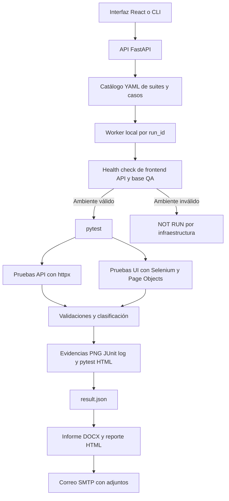

# Estrategia y Ejecución de Pruebas

## Proyecto Integrador de TQA

**Sistema evaluado:** IPAS IUS PUNIENDI  
**Estudiante:** Tamengo Sanchez Bustamante Calderon  
**Institución:** UNIFRANZ  
**Periodo documentado:** 1 de julio al 17 de noviembre de 2026  
**Fecha de cierre:** 17 de noviembre de 2026

Este documento presenta la estrategia, el diseño, la automatización, la ejecución y los resultados de las pruebas realizadas sobre IPAS. El alcance utiliza datos ficticios y un ambiente local QA separado de producción. El resultado principal fue la ejecución de 16 casos únicos, con 15 PASS y un FAIL funcional vinculado a BUG-01-F.

# Índice General

1. 6.1 Plan de Pruebas
2. 6.2 Pruebas Funcionales
3. 6.3 Pruebas Automatizadas
4. 6.4 Pruebas No Funcionales
5. 6.5 Ejecución de Pruebas
6. 6.6 Resultados
7. 6.7 Conclusiones
8. 6.8 Recomendaciones
9. Anexo A Casos de Prueba Completos
10. Anexo B Ejecuciones Completas
11. Anexo C Bug Reports
12. Anexo D Evidencias
13. Anexo E Reportes de Ejemplo
14. Anexo F Prompts de Inteligencia Artificial
15. Checklist Final

<!-- PAGEBREAK -->

# 6.1 Plan de Pruebas

**Proyecto:** IPAS IUS PUNIENDI  
**Autor, ejecutor y responsable:** Tamengo Sanchez Bustamante Calderon  
**Periodo del plan:** 1 de julio al 17 de noviembre de 2026  
**Ambiente:** local QA

## 6.1.1 Introducción

IPAS, denominado IUS PUNIENDI, es un sistema de gestión documental jurídica para un bufete de El Alto, Bolivia. La aplicación concentra procesos de autenticación, seguimiento público, gestión de expedientes, administración de documentos y control de acceso por roles. También incorpora servicios de inteligencia artificial para apoyo profesional; sin embargo, las respuestas generadas por IA requieren validación humana y no constituyen por sí mismas evidencia de una prueba.

En este capítulo presento la estrategia aplicada para evaluar IPAS mediante una plataforma independiente denominada `qa-platform`. Esta plataforma no forma parte del sistema bajo prueba: su función es seleccionar casos, preparar el ambiente, ejecutar pruebas sobre IPAS, conservar logs y capturas, generar reportes y registrar el envío por correo. La separación evita confundir el producto evaluado con la herramienta que realiza la evaluación.

El módulo principal considerado en el plan es la gestión de expedientes y documentos, complementado por la autenticación, el seguimiento público y los permisos necesarios para proteger información jurídica. Todas las pruebas se ejecutan con datos ficticios en la base `ius_puniendi_qa`.

## 6.1.2 Objetivo

El objetivo general es verificar el comportamiento funcional y el rendimiento básico de IPAS en un ambiente local controlado, utilizando casos reproducibles y evidencias técnicas que permitan comparar el resultado esperado con el observado.

Los objetivos específicos son:

- comprobar el acceso válido y el rechazo de entradas inválidas en autenticación;
- verificar la consulta pública protegida mediante NUREJ o CUD y CI;
- validar la creación y consulta de expedientes, incluidos campos obligatorios;
- comprobar la carga de documentos permitidos y los límites de tipo y tamaño;
- evaluar las restricciones de acceso por rol;
- verificar un recorrido E2E desde el inicio de sesión hasta la visualización de un expediente ficticio;
- medir la respuesta de endpoints locales bajo una carga moderada previamente definida;
- generar evidencias, resultados y reportes relacionados mediante un identificador único de corrida.

## 6.1.3 Alcance

El alcance comprende las funcionalidades y condiciones que cuentan con scripts, datos de prueba y resultados verificables.

| Área | Funcionalidades incluidas | Evidencia principal |
|---|---|---|
| Disponibilidad | Frontend, API y conexión con la base QA | TC-SMK-001 y health-check |
| Autenticación | Login válido, contraseña incorrecta, correo obligatorio y verificación JWT | TC-LOG-001 a TC-LOG-004 |
| Seguimiento público | Consulta válida y rechazo por CI incorrecto | TC-PUB-001 y TC-PUB-002 |
| Expedientes | Creación válida, campo obligatorio ausente y consulta inexistente | TC-EXP-001 a TC-EXP-003 |
| Documentos | PDF válido, extensión ejecutable y límite de 10 MB más 1 byte | TC-DOC-001 a TC-DOC-003 |
| Roles y permisos | Restricción del listado administrativo de usuarios | TC-ROL-001 |
| Flujo E2E | Login y visualización de QA-EXP-0001 en Gestión de Casos | TC-E2E-001 |
| Rendimiento | Login y consultas de expedientes y documentos en API local | TC-PERF-001 |

Las pruebas cubren la interfaz web en Microsoft Edge, los contratos HTTP de la API, la persistencia necesaria para los datos QA y el flujo entre frontend, backend y base de datos.

## 6.1.4 Fuera de alcance

Quedan fuera de alcance:

- el ambiente de producción y cualquier base con expedientes reales, debido a la sensibilidad de la información legal;
- la modificación correctiva del código de IPAS, porque el objetivo de `qa-platform` es detectar y documentar comportamientos, no corregir el SUT sin aprobación;
- las pruebas masivas contra endpoints de embeddings, generación o proveedores externos de IA, para evitar costos, límites de consumo y resultados no deterministas;
- las pruebas de estrés y soak, ya que sólo se ejecutó un escenario de carga moderada de 30 segundos;
- la medición de CPU, memoria, red y consumo de base de datos, porque no se habilitó una herramienta de monitoreo durante Locust;
- navegadores distintos de Microsoft Edge, dispositivos móviles y pruebas de accesibilidad, debido al tiempo y ambiente disponibles;
- CI/CD, porque la ejecución se implementó localmente y no existe un pipeline automatizado;
- retesting de BUG-01-F, porque el defecto continuaba abierto al cierre del 17 de noviembre de 2026.

## 6.1.5 Estrategia

La estrategia combina validaciones de API con `httpx`, pruebas de interfaz con Selenium WebDriver, ejecución y aserciones con pytest, Page Object Model para centralizar locators y Locust para el escenario no funcional. Los casos están catalogados en YAML y se seleccionan por suite, categoría o ID desde la API, la consola o el frontend de `qa-platform`.

Antes de cada corrida, el runner verifica la disponibilidad del frontend, la API y la base de datos. Si una condición de infraestructura falla, la corrida se marca como `FALLIDA` por infraestructura y los casos quedan `NOT RUN`; no se registran como FAIL funcionales. Cuando la preparación es correcta, pytest o Locust ejecutan los casos y generan resultados técnicos. Después se construyen el informe DOCX y el reporte HTML autocontenido. El correo se procesa únicamente cuando ambos archivos existen.

Los resultados se expresan como PASS, FAIL, SKIPPED y NOT RUN. Para mantener compatibilidad con la plantilla académica, SKIPPED se interpreta como equivalente operativo de BLOCKED cuando una condición impide continuar un caso. Esta equivalencia se explica una sola vez y no modifica los estados almacenados por la plataforma.

## 6.1.6 Niveles de prueba

Se utilizaron los siguientes niveles:

- **Integración:** se verificó la comunicación entre API, autenticación, base de datos, expedientes y documentos mediante solicitudes reales.
- **Sistema:** se evaluó IPAS completo en el ambiente local QA, incluidos frontend, API y PostgreSQL.
- **E2E:** se automatizó el recorrido del abogado desde el login hasta la visualización del expediente QA-EXP-0001.

No se desarrollaron pruebas unitarias dentro de este trabajo, porque `qa-platform` evalúa el sistema desplegado desde el exterior y no modifica las unidades internas del SUT.

## 6.1.7 Tipos de prueba

Se aplicaron pruebas funcionales positivas y negativas, pruebas de API, pruebas de interfaz, validaciones de campos obligatorios, partición de equivalencia, análisis de valores límite, pruebas de permisos, smoke, regresión y un flujo E2E. Como prueba no funcional se ejecutó carga moderada sobre endpoints locales.

El retesting no se realizó porque BUG-01-F no fue corregido. La suite de regresión se ejecutó de forma independiente del FAIL controlado: esto permitió comprobar los 14 casos estables sin ocultar el defecto conocido ni convertirlo en una falla inesperada de la suite.

## 6.1.8 Estrategia de automatización

Se automatizaron casos repetibles, con resultados observables y datos controlables. La selección priorizó autenticación, expedientes, documentos, seguimiento público y permisos por su relación con información jurídica y con los flujos principales del sistema.

Los criterios de selección fueron:

- prioridad alta o participación en un flujo crítico;
- posibilidad de preparar datos ficticios y limpiar registros temporales;
- resultado verificable mediante estado HTTP, contenido de respuesta, URL o elemento visible;
- ejecución repetible sin depender de documentos jurídicos reales;
- valor para smoke, regresión o validación de límites;
- disponibilidad de locators comprobados contra el DOM real para los casos UI.

Los locators se centralizaron en Page Objects y se verificaron con Selenium sobre el DOM renderizado. La generación asistida por IA no puede introducir selectores ajenos al registro aprobado. La ejecución real, y no la IA, determina siempre el estado PASS o FAIL.

## 6.1.9 Ambiente

| Elemento | Configuración utilizada |
|---|---|
| Sistema operativo | Microsoft Windows 10.0.26300, arquitectura x64 |
| Equipo | ASUS TUF Gaming F16 FX607JV |
| Navegador | Microsoft Edge 157.0.4341.60 |
| Frontend IPAS | Componente 0.1.0, React 19.2.0, puerto local 3000 |
| Backend IPAS | Componente 1.0.0, Node.js y Express, puerto local 4000 |
| Base de datos | PostgreSQL 17, base exclusiva `ius_puniendi_qa` |
| Servicio IA del SUT | FastAPI local, Ollama y Qwen3 8B cuando corresponde; excluido de carga masiva |
| Plataforma QA | Python 3.11.9, FastAPI, pytest 8.3.4, Selenium 4.27.1 y Locust 2.32.6 |
| Frontend QA | React 18.3.1, MUI 6.4.0 y Vite 6.0.7, puerto local 5173 |

No existe una versión integral única de IPAS; por ello se consignan las versiones observadas de sus componentes. Todas las URLs son locales y la base se valida antes del seed y antes de cada ejecución.

## 6.1.10 Datos de prueba

El seed crea usuarios ficticios con roles `superadmin`, `admin` y `abogado`. Las contraseñas permanecen en `.env` y no se incluyen en código, reportes, capturas ni prompts. También se crea un cliente ficticio con CI `QA-CI-0001` y el expediente `QA-EXP-0001`.

Los datos válidos incluyen credenciales QA, el NUREJ ficticio, el CI relacionado y archivos PDF generados en memoria. Los datos inválidos incluyen contraseña incorrecta, correo vacío, CI no relacionado, ausencia de un campo obligatorio, identificador inexistente y extensión ejecutable inerte. El valor límite documental corresponde a 10 MB más 1 byte, que supera exactamente el máximo permitido. Los casos que crean expedientes o documentos temporales realizan limpieza al finalizar.

## 6.1.11 Recursos y herramientas

| Recurso o herramienta | Uso en el proyecto |
|---|---|
| Python 3.11 y FastAPI | API orquestadora y servicios de la plataforma QA |
| pytest 8.3.4 | Ejecución, aserciones, markers y resultados JUnit |
| Selenium 4.27.1 | Automatización UI en Edge |
| Page Object Model | Encapsulación y reutilización de locators y acciones |
| httpx | Pruebas de endpoints reales y proveedor IA |
| Locust 2.32.6 | Carga local moderada y métricas de rendimiento |
| python-docx y Jinja2 | Informe DOCX y reporte HTML autocontenido |
| smtplib | Entrega de reportes después de su generación |
| React 18, MUI y Vite | Interfaz web de `qa-platform` |
| PostgreSQL 17 | Base exclusiva del ambiente QA |
| Git y OneDrive | Control local y almacenamiento, con riesgo de sincronización de artefactos pesados |
| Groq, modelo openai/gpt-oss-120b | Análisis asistido de requisitos con revisión humana |

## 6.1.12 Criterios de entrada

Una ejecución puede comenzar cuando:

- IPAS está levantado contra `ius_puniendi_qa`;
- el frontend responde en el puerto 3000 y la API en el puerto 4000;
- PostgreSQL 17 está disponible y contiene el esquema requerido;
- el seed ficticio fue aplicado y las credenciales QA están configuradas;
- el navegador y su driver son compatibles;
- la suite o los casos seleccionados existen en el catálogo;
- el correo tiene formato válido cuando la corrida se inicia desde la plataforma;
- el health-check confirma frontend, API y base antes de ejecutar casos.

## 6.1.13 Criterios de salida

La etapa de pruebas se considera cerrada cuando los casos seleccionados tienen PASS, FAIL, BLOCKED/SKIPPED o NOT RUN justificado; los resultados se relacionan con un `run_id`; los FAIL fueron analizados para distinguir defecto funcional de error de infraestructura; las evidencias y logs están conservados; y los dos reportes fueron generados cuando la corrida se inició mediante el orquestador.

Para la suite estable se exige que no existan FAIL inesperados ni NOT RUN por infraestructura. El escenario de carga cumple su criterio cuando el p95 es menor a 2.000 ms y la tasa de errores menor a 1 %. Un defecto controlado puede permanecer abierto siempre que esté documentado, separado de la regresión estable y acompañado de su evidencia.

## 6.1.14 Gestión de defectos

Cada defecto se relaciona con el caso que lo detectó y con la corrida que reproduce el comportamiento. El registro incluye ID, título, descripción, pasos, resultado actual, resultado esperado, prioridad, severidad, ambiente, adjuntos, estado y responsable.

BUG-01-F se relaciona con TC-ROL-001. El comportamiento observado fue HTTP 200 al consultar el listado de usuarios con un token de abogado; se esperaba HTTP 403. Al 17 de noviembre de 2026 el defecto permanece **Abierto, pendiente de corrección**, con Tamengo Sanchez Bustamante Calderon como responsable de seguimiento. Después de una corrección deberá ejecutarse primero el retesting de TC-ROL-001 y luego la suite de regresión.

## 6.1.15 Riesgos y contingencias

| Riesgo | Impacto | Acción de contingencia |
|---|---|---|
| Exposición de datos jurídicos o personales | Alto | Usar únicamente `ius_puniendi_qa`, datos ficticios, archivos generados y capturas revisadas. |
| Ejecución accidental sobre otra base | Alto | Bloquear configuración y seed si el nombre no es exactamente `ius_puniendi_qa`. |
| IPAS, driver o PostgreSQL no disponibles | Alto | Ejecutar health-check; marcar infraestructura y dejar casos NOT RUN. |
| Dependencia de Groq, Ollama u otro servicio IA | Medio | Mantener revisión humana, no usar IA para decidir PASS/FAIL y permitir proveedor configurable. |
| Selectores UI inestables | Medio | Usar Page Objects y registro verificado contra el DOM; solicitar confirmación de locators nuevos. |
| OneDrive bloquea o sincroniza artefactos pesados | Medio | Excluir `.venv`, `node_modules`, `reports` y `evidencias` cuando sea posible; trabajar temporalmente fuera de la carpeta sincronizada. |
| Claves presentes en archivos de código | Alto | No reproducirlas en documentación; migrarlas a variables de entorno con aprobación y rotarlas si corresponde. |
| SMTP falla después de ejecutar pruebas | Medio | Conservar DOCX y HTML localmente, registrar error de infraestructura y permitir reenvío. |
| Carga afecta servicios externos de IA | Alto | Excluir endpoints de IA y ejecutar Locust sólo sobre IPAS local. |

## 6.1.16 Cronograma

| Periodo 2026 | Actividad | Responsable | Resultado previsto |
|---|---|---|---|
| 1 al 15 de julio | Exploración de IPAS, módulos, endpoints, roles y riesgos | Tamengo Sanchez Bustamante Calderon | Inventario técnico y alcance inicial |
| 16 al 31 de julio | Preparación de `ius_puniendi_qa`, seed y primer caso Selenium | Tamengo Sanchez Bustamante Calderon | Ambiente seguro y prueba smoke |
| 1 al 31 de agosto | Catálogo, casos API, Page Objects y runner | Tamengo Sanchez Bustamante Calderon | Suites funcionales trazables |
| 1 al 20 de septiembre | Reportes DOCX y HTML, API orquestadora | Tamengo Sanchez Bustamante Calderon | Resultados descargables por `run_id` |
| 21 de septiembre al 10 de octubre | Correo SMTP y frontend React | Tamengo Sanchez Bustamante Calderon | Ejecución y seguimiento desde interfaz |
| 11 al 31 de octubre | Prueba de carga Locust y análisis de métricas | Tamengo Sanchez Bustamante Calderon | Evidencia no funcional |
| 1 al 15 de noviembre | Módulo IA, validación de selectores y revisión humana | Tamengo Sanchez Bustamante Calderon | Análisis IA auditable |
| 16 y 17 de noviembre | Regresión final, FAIL controlado e inventario documental | Tamengo Sanchez Bustamante Calderon | Cierre técnico y fuentes del Capítulo 6 |

## 6.1.17 Entregables

Los entregables del plan son:

- catálogo versionado de suites y casos;
- scripts funcionales API, UI y E2E;
- Page Objects y registro de locators verificados;
- seed de usuarios, cliente y expediente ficticios;
- runner con health-check, clasificación de fallos y resultados por `run_id`;
- escenario Locust con CSV, log y métricas reales;
- evidencias PNG, JUnit, logs y HTML de pytest;
- informe detallado DOCX y reporte HTML autocontenido;
- registro del envío SMTP;
- módulo IA auditable con revisión humana;
- casos completos en `docs/tc`, ejecuciones en `docs/ejecuciones` y bug report en `docs/bugs`;
- Capítulo 6, anexos y checklist final de la guía del curso.

Este plan se cierra el 17 de noviembre de 2026 con la plataforma técnica implementada y con la documentación académica en elaboración progresiva por secciones.

<!-- PAGEBREAK -->

# 6.2 Pruebas Funcionales

**Proyecto:** IPAS IUS PUNIENDI  
**Autor y diseñador de pruebas:** Tamengo Sanchez Bustamante Calderon  
**Periodo documentado:** 1 de julio al 17 de noviembre de 2026

Las pruebas funcionales verifican que IPAS responda de acuerdo con el comportamiento esperado en autenticación, seguimiento público, expedientes, documentos, roles y acceso al expediente jurídico ficticio. En esta sección presento el diseño de las pruebas; los resultados observados, las evidencias y el análisis de fallos se desarrollan en las secciones de ejecución y resultados.

## 6.2.1 Funcionalidades

| Funcionalidad | Módulo | Descripción |
|---|---|---|
| Autenticación interna | Autenticación | Permite el ingreso de usuarios internos con correo y contraseña, valida campos obligatorios y verifica el token de sesión. |
| Seguimiento público | Consulta pública | Permite consultar información pública de un expediente únicamente cuando coinciden el NUREJ o CUD y el CI relacionado. |
| Gestión de expedientes | Expedientes | Permite crear y consultar expedientes, con validación de campos obligatorios y tratamiento de identificadores inexistentes. |
| Gestión de documentos | Documentos | Permite adjuntar documentos a un expediente y valida el tipo y el tamaño del archivo. |
| Control de acceso por rol | Usuarios y permisos | Restringe las operaciones administrativas según el rol autenticado. |
| Recorrido jurídico de abogado | Autenticación y expedientes | Permite que un abogado inicie sesión, ingrese a Gestión de Casos y visualice el expediente ficticio asignado. |
| Disponibilidad integral QA | Infraestructura local | Comprueba la disponibilidad del frontend, la API y la conexión exclusiva con la base `ius_puniendi_qa`. Es una condición técnica de entrada y no un requisito funcional del usuario. |

## 6.2.2 Requisitos

Los identificadores se asignaron con fines de trazabilidad documental a partir de funciones verificadas en el código y en las pruebas reales. No representan requisitos nuevos.

| ID | Descripción |
|---|---|
| RF-01 | El sistema debe autenticar a usuarios internos mediante correo y contraseña y rechazar credenciales o campos obligatorios inválidos. |
| RF-02 | El sistema debe verificar un token de sesión válido y devolver la identidad y el rol asociados. |
| RF-03 | El sistema debe permitir el seguimiento público de un expediente únicamente cuando coincidan el NUREJ o CUD y el CI relacionado. |
| RF-04 | El sistema debe permitir crear y consultar expedientes jurídicos, validando sus campos obligatorios y la inexistencia de identificadores consultados. |
| RF-05 | El sistema debe permitir cargar documentos de formatos autorizados y rechazar extensiones no permitidas o archivos superiores a 10 MB. |
| RF-06 | El sistema debe restringir las operaciones administrativas según el rol autenticado. |
| RF-07 | Un abogado autenticado debe poder acceder a Gestión de Casos y visualizar el expediente ficticio asignado en el ambiente QA. |

El requisito no funcional RNF-01 se documenta en la sección 6.4 porque corresponde al rendimiento de la API y no al comportamiento funcional.

## 6.2.3 Criterios de Aceptación

| Requisito | Criterios verificables de aceptación |
|---|---|
| RF-01 | Las credenciales válidas de un abogado permiten acceder a su panel. Una contraseña incorrecta produce HTTP 401. Un correo vacío produce HTTP 400 con un mensaje de campos obligatorios. |
| RF-02 | Un token válido produce HTTP 200 y devuelve el correo ficticio y el rol `abogado` asociados. |
| RF-03 | La combinación válida `QA-EXP-0001` y `QA-CI-0001` produce HTTP 200 y devuelve el NUREJ solicitado. Un CI no relacionado produce HTTP 404 y no expone información del expediente. |
| RF-04 | Un expediente con los campos obligatorios se crea con HTTP 201 y puede eliminarse durante la limpieza con HTTP 204. La ausencia del campo delito produce HTTP 400. La consulta de un ID inexistente produce HTTP 404. |
| RF-05 | Un PDF sintético permitido se carga con HTTP 201 y puede eliminarse con HTTP 204. Un archivo `.exe` y un PDF superior a 10 MB se rechazan con HTTP 400. |
| RF-06 | Un usuario con rol `abogado` que solicita el listado administrativo de usuarios debe recibir HTTP 403 y no debe obtener dicho listado. |
| RF-07 | Después de autenticarse desde la interfaz, el abogado accede a Gestión de Casos y visualiza `QA-EXP-0001` en la tabla. |

## 6.2.4 Técnicas de Diseño

### Partición de Equivalencia

La partición de equivalencia permitió agrupar entradas que debían producir el mismo comportamiento, sin repetir combinaciones equivalentes:

- credenciales válidas e inválidas en TC-LOG-001 y TC-LOG-002;
- CI relacionado y CI no relacionado con el expediente en TC-PUB-001 y TC-PUB-002;
- expediente con campos obligatorios y expediente sin delito en TC-EXP-001 y TC-EXP-002;
- formato permitido PDF y formato no permitido EXE en TC-DOC-001 y TC-DOC-002;
- rol `abogado` sin privilegios administrativos en TC-ROL-001.

### Valores Límite

TC-LOG-003 utiliza la cadena vacía, equivalente a longitud cero, como límite inferior del campo obligatorio correo. TC-DOC-003 utiliza un PDF sintético de 10.485.770 bytes: el contenido construido por el script contiene una cabecera PDF de 9 bytes y 10 MB más 1 byte de relleno. Por tanto, el tamaño total supera el máximo permitido de 10 MB en 10 bytes y verifica el primer intervalo no válido cercano al límite superior.

### Tabla de Decisión

La siguiente tabla resume las combinaciones implementadas para la carga de documentos. En los tres casos el usuario está autenticado y el expediente ficticio existe.

| Regla | Extensión permitida | Tamaño hasta 10 MB | Resultado esperado | Caso |
|---|---:|---:|---|---|
| R1 | Sí, PDF | Sí | HTTP 201 y documento creado | TC-DOC-001 |
| R2 | No, EXE | Sí | HTTP 400 por tipo no permitido | TC-DOC-002 |
| R3 | Sí, PDF | No | HTTP 400 por archivo demasiado grande | TC-DOC-003 |

## 6.2.5 Casos de Prueba

### Catálogo Funcional

| ID | Funcionalidad | Qué se verifica | Resultado esperado |
|---|---|---|---|
| TC-SMK-001 | Disponibilidad integral QA | Frontend, API y base exclusiva de pruebas | Frontend HTTP 200, API accesible y base `ius_puniendi_qa` |
| TC-LOG-001 | Login válido | Acceso de abogado desde la interfaz | Dashboard del abogado visible |
| TC-LOG-002 | Login inválido | Rechazo de contraseña incorrecta | HTTP 401 y mensaje `Password incorrecto` |
| TC-LOG-003 | Correo obligatorio | Rechazo de correo vacío | HTTP 400 y mensaje de campos obligatorios |
| TC-LOG-004 | Verificación de sesión | Identidad y rol de un token válido | HTTP 200, correo ficticio y rol `abogado` |
| TC-PUB-001 | Seguimiento público | Consulta con NUREJ y CI relacionados | HTTP 200 y NUREJ `QA-EXP-0001` |
| TC-PUB-002 | Protección de consulta pública | Consulta con CI no relacionado | HTTP 404 y `success=false` |
| TC-EXP-001 | Creación de expediente | Alta con campos obligatorios y limpieza | HTTP 201, datos persistidos y limpieza HTTP 204 |
| TC-EXP-002 | Validación de expediente | Ausencia del campo delito | HTTP 400 y mensaje de campos requeridos |
| TC-EXP-003 | Consulta de expediente | Identificador inexistente | HTTP 404 |
| TC-DOC-001 | Carga de documento | PDF sintético permitido y limpieza | HTTP 201 y limpieza HTTP 204 |
| TC-DOC-002 | Validación de extensión | Archivo ejecutable no permitido | HTTP 400 y mensaje de tipos permitidos |
| TC-DOC-003 | Validación de tamaño | PDF superior a 10 MB | HTTP 400 y mensaje `File too large` |
| TC-ROL-001 | Control de acceso | Abogado intenta listar usuarios | HTTP 403 sin listado de usuarios |
| TC-E2E-001 | Recorrido jurídico | Login y visualización del expediente ficticio | `QA-EXP-0001` visible en Gestión de Casos |

Los casos completos se incorporan en el Anexo A. A continuación se presentan tres casos representativos en el formato de diseño utilizado para el proyecto.

### Caso Representativo TC-LOG-001

| Campo | Contenido |
|---|---|
| ID | TC-LOG-001 |
| Nombre | Login válido de abogado desde la interfaz |
| Requisito | RF-01 |
| Módulo | Autenticación |
| Tipo y prioridad | Funcional positivo, prioridad alta |
| Objetivo | Verificar el acceso de un abogado QA mediante la interfaz web. |
| Precondiciones | Frontend y API disponibles; usuario abogado ficticio activo; navegador Edge compatible. |
| Datos | Correo ficticio configurado por el seed; contraseña protegida en `.env` y excluida de las evidencias. |
| Pasos | 1. Abrir la página pública de IPAS. 2. Abrir el diálogo de autenticación. 3. Ingresar las credenciales QA y confirmar. 4. Esperar la carga del panel. |
| Resultado esperado | El sistema navega a `/abogado/dashboard` y muestra el encabezado `Mi panel de trabajo`. |
| Postcondición | La sesión del abogado permanece activa para la validación del panel. |

### Caso Representativo TC-DOC-003

| Campo | Contenido |
|---|---|
| ID | TC-DOC-003 |
| Nombre | Rechazar archivo mayor a 10 MB |
| Requisito | RF-05 |
| Módulo | Documentos |
| Tipo y prioridad | Valor límite negativo, prioridad alta |
| Objetivo | Validar el límite superior de 10 MB para documentos. |
| Precondiciones | Abogado QA autenticado; expediente `QA-EXP-0001` existente. |
| Datos | PDF sintético generado en memoria, de 10.485.770 bytes y sin información jurídica real. |
| Pasos | 1. Generar el contenido PDF superior al límite. 2. Enviar el archivo mediante `multipart` al endpoint del expediente. 3. Revisar el código y el mensaje de respuesta. |
| Resultado esperado | HTTP 400 con el mensaje `File too large`; el documento no se registra. |
| Postcondición | No requiere limpieza porque la carga debe ser rechazada. |

### Caso Representativo TC-ROL-001

| Campo | Contenido |
|---|---|
| ID | TC-ROL-001 |
| Nombre | Abogado no puede listar usuarios |
| Requisito | RF-06 |
| Módulo | Roles y permisos |
| Tipo y prioridad | Seguridad funcional negativa, prioridad alta |
| Objetivo | Impedir que un abogado obtenga el listado administrativo de usuarios. |
| Precondiciones | Usuario abogado QA autenticable; endpoint `/usuarios` disponible. |
| Datos | Rol ficticio `abogado`; token generado durante la prueba y no guardado en reportes. |
| Pasos | 1. Autenticar al abogado QA. 2. Enviar `GET /usuarios` con el token. 3. Verificar el código de respuesta y la ausencia del listado. |
| Resultado esperado | HTTP 403 sin listado de usuarios. |
| Relación con defectos | El resultado observado se documenta como BUG-01-F en las secciones 6.5 y 6.6; no modifica el resultado esperado del caso. |

## 6.2.6 Datos de Prueba

Todos los datos son ficticios o se generan durante la ejecución. Las contraseñas y los tokens permanecen en memoria o en el archivo local `.env`, que no se incorpora a evidencias ni al repositorio.

| Categoría | Datos utilizados | Clasificación y tratamiento |
|---|---|---|
| Usuarios y roles | Cuentas QA con roles `superadmin`, `admin` y `abogado` | Ficticios; credenciales protegidas en `.env` |
| Cliente | CI `QA-CI-0001` | Ficticio; creado por el seed QA |
| Expediente base | NUREJ `QA-EXP-0001` | Ficticio; creado por el seed QA |
| Expediente temporal | `QA-AUTO-<uuid>` | Generado por ejecución y eliminado al finalizar el caso |
| Consulta inválida | CI `CI-NO-VALIDO` e ID `999999999` | Particiones inválidas sin relación con personas o expedientes reales |
| Documento válido | `evidencia_qa.pdf` | Contenido PDF mínimo generado en memoria y eliminado al finalizar |
| Extensión inválida | `malware.exe` | Nombre de prueba con contenido inerte generado en memoria |
| Tamaño inválido | PDF de 10.485.770 bytes | Archivo sintético generado en memoria, superior al límite de 10 MB |
| Token | JWT obtenido durante el login | Temporal; no se imprime ni se incorpora a reportes |

La preparación se realiza exclusivamente sobre `ius_puniendi_qa`. Los casos que crean expedientes o documentos ejecutan una limpieza posterior. Ningún documento jurídico real forma parte del conjunto de pruebas.

## 6.2.7 Cobertura

La cobertura funcional se calcula sobre los siete requisitos funcionales documentados, RF-01 a RF-07. RNF-01 se excluye de esta base porque se evalúa mediante TC-PERF-001 en la sección de pruebas no funcionales. TC-SMK-001 también se excluye del numerador porque verifica condiciones técnicas de entrada y no un requisito funcional del usuario.

| Requisito | Funcionalidad | Casos asociados |
|---|---|---|
| RF-01 | Autenticación interna | TC-LOG-001, TC-LOG-002, TC-LOG-003 |
| RF-02 | Verificación de sesión | TC-LOG-004 |
| RF-03 | Seguimiento público | TC-PUB-001, TC-PUB-002 |
| RF-04 | Gestión de expedientes | TC-EXP-001, TC-EXP-002, TC-EXP-003 |
| RF-05 | Gestión de documentos | TC-DOC-001, TC-DOC-002, TC-DOC-003 |
| RF-06 | Control de acceso por rol | TC-ROL-001 |
| RF-07 | Recorrido jurídico de abogado | TC-E2E-001 |

**Fórmula:** cobertura de requisitos funcionales = requisitos funcionales con al menos un caso diseñado / total de requisitos funcionales documentados × 100.

**Cálculo:** 7 / 7 × 100 = **100 % de cobertura de requisitos funcionales documentados**.

Este porcentaje expresa cobertura de diseño, no porcentaje de PASS ni cobertura de automatización. La cobertura no demuestra por sí sola que todos los requisitos funcionen correctamente; únicamente confirma que cada requisito funcional documentado tiene al menos un caso relacionado.

<!-- PAGEBREAK -->

# 6.3 Pruebas Automatizadas

**Proyecto:** IPAS IUS PUNIENDI  
**Autor, implementador y ejecutor:** Tamengo Sanchez Bustamante Calderon  
**Periodo documentado:** 1 de julio al 17 de noviembre de 2026

La automatización se implementó en `qa-platform`, una plataforma separada de la aplicación probada IPAS. Esta separación permite ejecutar pruebas, conservar evidencias y generar reportes sin incorporar código de pruebas dentro del SUT. Al cierre del 17 de noviembre de 2026, los 15 casos funcionales seleccionados tenían scripts ejecutables; la suite estable obtuvo 14 PASS y el caso de permisos se mantuvo como FAIL controlado vinculado a BUG-01-F.

## 6.3.1 Objetivo

El objetivo fue automatizar los escenarios funcionales repetibles y de mayor prioridad de IPAS, incluyendo validaciones positivas, negativas, de límite, de roles y de recorrido completo. La plataforma debía comprobar primero el ambiente, ejecutar únicamente contra `ius_puniendi_qa`, clasificar los resultados, conservar evidencia por `run_id` y producir reportes trazables.

## 6.3.2 Alcance y Selección

La selección priorizó funciones críticas, resultados deterministas, datos ficticios controlables y escenarios que podían limpiarse después de la ejecución. Se excluyeron procesos con documentos jurídicos reales, servicios externos no necesarios y pruebas que pudieran modificar una base distinta de QA.

| ID | Funcionalidad | ¿Se automatiza? | Prioridad | Justificación | Herramienta |
|---|---|---|---|---|---|
| TC-SMK-001 | Disponibilidad integral | Sí | Alta | Bloquea ejecuciones sobre un ambiente incorrecto | pytest, httpx, psycopg |
| TC-LOG-001 | Login válido por interfaz | Sí | Alta | Flujo principal de acceso interno | Selenium, pytest |
| TC-LOG-002 | Contraseña incorrecta | Sí | Alta | Validación negativa determinista | httpx, pytest |
| TC-LOG-003 | Correo vacío | Sí | Alta | Límite inferior de un campo obligatorio | httpx, pytest |
| TC-LOG-004 | Token válido | Sí | Alta | Confirma identidad y rol de la sesión | httpx, pytest |
| TC-PUB-001 | Seguimiento público válido | Sí | Alta | Función pública vinculada al expediente | httpx, pytest |
| TC-PUB-002 | CI incorrecto | Sí | Alta | Protege información frente a una combinación inválida | httpx, pytest |
| TC-EXP-001 | Crear expediente | Sí | Alta | Operación central con limpieza controlada | httpx, pytest |
| TC-EXP-002 | Expediente sin delito | Sí | Alta | Valida un campo obligatorio | httpx, pytest |
| TC-EXP-003 | Expediente inexistente | Sí | Media | Confirma tratamiento de identificadores ausentes | httpx, pytest |
| TC-DOC-001 | Cargar PDF | Sí | Alta | Flujo principal con archivo sintético y limpieza | httpx, pytest |
| TC-DOC-002 | Rechazar EXE | Sí | Alta | Control de formato de archivo | httpx, pytest |
| TC-DOC-003 | Rechazar archivo superior a 10 MB | Sí | Alta | Control de límite de tamaño | httpx, pytest |
| TC-ROL-001 | Restringir listado de usuarios | Sí | Alta | Verifica autorización en servidor | httpx, pytest |
| TC-E2E-001 | Login y expediente visible | Sí | Alta | Recorre interfaz, navegación y datos QA | Selenium, pytest |

## 6.3.3 Herramientas y Versiones

| Herramienta o componente | Versión utilizada | Uso en la solución |
|---|---|---|
| Python | 3.11.9 | Lenguaje de la plataforma y los scripts |
| pytest | 8.3.4 | Motor principal de ejecución funcional |
| Selenium | 4.27.1 | Automatización de Edge e interacción con IPAS |
| httpx | 0.28.1 | Solicitudes HTTP contra la API del SUT |
| FastAPI | 0.115.6 | API local del orquestador |
| psycopg | 3.2.3 | Health-check y seed sobre PostgreSQL |
| pytest-html | 4.1.1 | Reporte técnico autocontenido de pytest |
| python-docx | 1.1.2 | Informe detallado DOCX |
| Jinja2 | 3.1.5 | Reporte HTML de la plataforma |
| React | 18.3.1 | Interfaz de `qa-platform` |
| Material UI | 6.4.0 | Componentes de la interfaz QA |
| Vite | 6.0.7 | Desarrollo y construcción del frontend QA |
| Microsoft Edge | 157.0.4341.60 | Navegador de las pruebas UI |
| Groq | API compatible con OpenAI | Proveedor del asistente IA |
| Modelo IA | `openai/gpt-oss-120b` | Análisis previo de requisitos |

pytest se eligió como herramienta principal porque permite ejecutar en un mismo flujo pruebas de API y pruebas UI, aplicar marcadores por módulo, parametrizar fixtures, generar JUnit y HTML y devolver códigos de salida interpretables por el runner. Selenium se utilizó únicamente cuando la verificación requería interacción con la interfaz renderizada; los demás casos se resolvieron por API para reducir tiempo y fragilidad.

## 6.3.4 Arquitectura y Funcionamiento



El catálogo relaciona cada ID con su `nodeid`. El worker crea el `run_id`, registra inicialmente los casos como NOT RUN, ejecuta el preflight y llama a pytest solo si el ambiente es seguro. El parser de JUnit transforma los estados en PASS, FAIL, SKIPPED o NOT RUN. Para el informe académico, SKIPPED se interpreta como BLOCKED porque representa un caso que no pudo continuar por una condición de ejecución.

## 6.3.5 Estructura Real del Proyecto

```text
qa-platform/
├── backend/
│   ├── ai/                 # Proveedor Groq/Anthropic y revisión humana
│   ├── api/                # FastAPI, esquemas y worker
│   ├── mailer/             # Envío SMTP de reportes
│   ├── reports/            # Generador DOCX y HTML
│   └── runner/             # Catálogo, health-check, pytest y Locust
├── config/
│   ├── test_catalog.yaml
│   ├── test_details.yaml
│   └── dom_selectors.json
├── data/seed/              # Usuarios, cliente y expediente ficticios
├── docs/                   # TC, ejecuciones, bugs, IA y Capítulo 6
├── evidencias/<run_id>/    # Capturas por caso
├── frontend/src/           # Interfaz React de la plataforma
├── pages/                  # Page Objects de IPAS
├── reports/<run_id>/       # Resultados y reportes
├── scripts/                # Preparación, arranque e inspección DOM
└── tests/
    ├── api/
    ├── functional/
    └── non_functional/
```

## 6.3.6 Diseño e Implementación de Scripts

### Page Object Model y Locators

Las interacciones UI se concentraron en `LoginPage` y `CasesPage`. Los siete locators se verificaron contra el DOM renderizado el 17 de noviembre de 2026. Se utilizaron textos y etiquetas observables en lugar de clases CSS generadas por Material UI.

```python
class LoginPage:
    ACCESS_BUTTON = (By.XPATH, "//button[normalize-space()='Acceso equipo']")
    EMAIL = (By.XPATH, "//label[normalize-space()='Correo institucional']/following::input[1]")
    SUBMIT = (By.XPATH, "//button[normalize-space()='Ingresar']")

    def wait_for_dashboard(self, role: str) -> None:
        expected_fragment = f"/{role}/dashboard"
        self.wait.until(lambda driver: expected_fragment in driver.current_url)
        self.wait.until(ec.visibility_of_element_located(self.DASHBOARD_HEADING))
```

### Validaciones y Reutilización

Las pruebas de API reutilizan fixtures para el cliente HTTP, la autenticación por rol y el ID del expediente QA. Los recursos temporales se eliminan dentro del mismo caso. El control de permisos conserva una aserción explícita que permite vincular el fallo con BUG-01-F.

```python
response = api_client.get("/usuarios", headers=auth_headers("abogado"))
assert response.status_code == 403, (
    "BUG-01-F: un abogado autenticado pudo listar usuarios; "
    f"respuesta HTTP observada={response.status_code}"
)
```

### Manejo de Errores

El runner diferencia un fallo funcional de un problema de infraestructura. Si el preflight falla, los casos quedan NOT RUN; si pytest omite un caso, el estado técnico es SKIPPED; si una aserción no coincide con el resultado del SUT, se registra FAIL funcional. Cada ejecución conserva el log, JUnit, HTML de pytest y `result.json`, incluso cuando termina fallida.

## 6.3.7 Funcionalidades Automatizadas

| Módulo | Escenario automatizado | Casos | Herramienta | Estado de implementación |
|---|---|---|---|---|
| Infraestructura | Disponibilidad y base QA exclusiva | TC-SMK-001 | httpx, psycopg, pytest | Completo |
| Autenticación | Login UI, rechazo y token | TC-LOG-001 a TC-LOG-004 | Selenium, httpx, pytest | Completo |
| Seguimiento público | Consulta válida e inválida | TC-PUB-001, TC-PUB-002 | httpx, pytest | Completo |
| Expedientes | Creación, validación y consulta ausente | TC-EXP-001 a TC-EXP-003 | httpx, pytest | Completo |
| Documentos | PDF válido, extensión y tamaño | TC-DOC-001 a TC-DOC-003 | httpx, pytest | Completo |
| Roles | Restricción del listado de usuarios | TC-ROL-001 | httpx, pytest | Completo; detecta defecto del SUT |
| Flujo E2E | Login y expediente visible | TC-E2E-001 | Selenium, pytest | Completo |

## 6.3.8 Relación entre Casos y Scripts

| ID | Script o función | Herramienta | Ubicación |
|---|---|---|---|
| TC-SMK-001 | `test_ipas_local_health` | pytest, httpx, psycopg | `tests/api/test_health_contract.py` |
| TC-LOG-001 | `test_login_abogado_valido` | pytest, Selenium | `tests/functional/test_login_smoke.py` |
| TC-LOG-002 | `test_login_rechaza_password_incorrecto` | pytest, httpx | `tests/api/test_auth_api.py` |
| TC-LOG-003 | `test_login_requiere_email` | pytest, httpx | `tests/api/test_auth_api.py` |
| TC-LOG-004 | `test_verify_acepta_token_valido` | pytest, httpx | `tests/api/test_auth_api.py` |
| TC-PUB-001 | `test_seguimiento_publico_valido` | pytest, httpx | `tests/api/test_public_tracking.py` |
| TC-PUB-002 | `test_seguimiento_publico_ci_incorrecto` | pytest, httpx | `tests/api/test_public_tracking.py` |
| TC-EXP-001 | `test_crear_expediente_valido` | pytest, httpx | `tests/api/test_cases_api.py` |
| TC-EXP-002 | `test_crear_expediente_sin_campo_obligatorio` | pytest, httpx | `tests/api/test_cases_api.py` |
| TC-EXP-003 | `test_consultar_expediente_inexistente` | pytest, httpx | `tests/api/test_cases_api.py` |
| TC-DOC-001 | `test_cargar_documento_pdf_valido` | pytest, httpx | `tests/api/test_documents_api.py` |
| TC-DOC-002 | `test_rechazar_extension_no_permitida` | pytest, httpx | `tests/api/test_documents_api.py` |
| TC-DOC-003 | `test_rechazar_archivo_superior_a_10mb` | pytest, httpx | `tests/api/test_documents_api.py` |
| TC-ROL-001 | `test_abogado_no_puede_listar_usuarios` | pytest, httpx | `tests/api/test_roles_api.py` |
| TC-E2E-001 | `test_abogado_visualiza_expediente_qa` | pytest, Selenium | `tests/functional/test_e2e_case_visibility.py` |

## 6.3.9 Datos y Configuración

La configuración se carga desde `.env` y no se versiona. Incluye las URL locales, el nombre fijo `ius_puniendi_qa`, el navegador, tiempos de espera, cuentas ficticias por rol, SMTP y el proveedor IA. Las contraseñas, tokens y claves no aparecen en reportes. Los datos estables son `QA-CI-0001` y `QA-EXP-0001`; los expedientes temporales usan UUID y se eliminan. Los archivos de prueba se generan en memoria.

## 6.3.10 Ejecución

La automatización requiere Windows, Python 3.11, Edge compatible, PostgreSQL 17, IPAS local conectado a `ius_puniendi_qa` y las dependencias de `requirements.txt`. Los comandos documentados son:

```powershell
python -m data.seed.seed_qa
python -m backend.runner.health
python -m backend.runner.run --suite regression
python -m backend.runner.run --suite controlled_fail
```

La API orquestadora se ejecuta mediante `python -m uvicorn backend.api.main:app --host 127.0.0.1 --port 8080`. La interfaz React consume esa API y permite seleccionar suites o casos. Los resultados se escriben en `reports/<run_id>/` y las capturas en `evidencias/<run_id>/<TC>/`.

## 6.3.11 Evidencias

| Código | Caso o proceso | Evidencia real |
|---|---|---|
| EV-01 | Regresión funcional | `reports/4a2c9ce1-0a85-4208-91bb-f9dd03db004b/result.json` |
| EV-02 | Regresión funcional | JUnit, log y HTML de pytest del mismo `run_id` |
| EV-03 | TC-LOG-001 | Tres capturas PNG del acceso, diálogo y dashboard |
| EV-04 | TC-E2E-001 | Dos capturas PNG del dashboard y Gestión de Casos |
| EV-05 | TC-ROL-001 | `result.json`, JUnit, log y HTML del `run_id` `dd68354b-0cb1-4d65-8d8e-f23d4b83142c` |
| EV-06 | Generación de reportes | DOCX y HTML del smoke `4a5768c2-f856-4f88-ac8f-787dd0ad47d4` |
| EV-07 | Correo SMTP | Objeto `email_delivery` con estado ENVIADO en el resultado del smoke |
| EV-08 | Asistente IA | Entrada, prompt y resultado bajo `docs/ia/feeaf1ec-4d07-4e3b-901e-89e582f58d20/` |

Las capturas demuestran la ejecución UI; los casos de API se respaldan con JUnit, logs y resultados estructurados. El código fuente explica la implementación, pero no se utiliza como prueba de ejecución.

## 6.3.12 Cobertura de Automatización

La base está formada por los 15 casos funcionales seleccionados para automatizar. TC-PERF-001 se excluye porque su cobertura se analiza en 6.4.

**Fórmula:** cobertura de automatización = casos automatizados / casos seleccionados para automatizar × 100.

**Cálculo:** 15 / 15 × 100 = **100 % de cobertura de automatización funcional seleccionada**.

Este valor indica que todos los casos seleccionados tienen un script ejecutable. No implica 100 % de funcionalidades posibles de IPAS ni 100 % de PASS.

## 6.3.13 Resultados de Ejecución Automatizada

| Fecha y hora | Suite | Ambiente | Total | PASS | FAIL | BLOCKED | NOT RUN | Duración | Evidencia |
|---|---|---|---:|---:|---:|---:|---:|---:|---|
| 17/11/2026 00:33 | Smoke | Windows local QA, Edge, PostgreSQL 17 | 2 | 2 | 0 | 0 | 0 | 21,218 s | EV-06, EV-07 |
| 17/11/2026 12:49 | Regresión estable | Windows local QA, Edge, `ius_puniendi_qa` | 14 | 14 | 0 | 0 | 0 | 29,139 s | EV-01 a EV-04 |
| 17/11/2026 12:50 | FAIL controlado | Windows local QA, API IPAS | 1 | 0 | 1 | 0 | 0 | 4,579 s | EV-05 |

En estas ejecuciones no hubo SKIPPED; por tanto, BLOCKED fue cero. La regresión estable excluyó deliberadamente TC-ROL-001 y verificó 14 casos sin fallos. TC-ROL-001 se ejecutó aparte: el SUT devolvió HTTP 200 y un listado de usuarios a un abogado, cuando el resultado esperado era HTTP 403. El ambiente estaba disponible y la aserción correspondía al requisito, por lo que la causa se clasificó como fallo funcional del SUT y se registró BUG-01-F. No fue un error del script, de los datos ni de infraestructura.

## 6.3.14 Integración y Entrega Continua

**No implementado.** Las ejecuciones se realizan localmente mediante CLI o la interfaz de `qa-platform`. Como mejora futura se propone incorporar un flujo CI/CD que instale dependencias, ejecute pruebas que no requieran UI visible, publique JUnit y HTML, y mantenga los secretos en el almacén seguro del proveedor. La automatización de UI y el acceso a PostgreSQL QA requerirán un runner controlado.

## 6.3.15 Mantenimiento Reutilización y Limitaciones

Los Page Objects centralizan locators y esperas; los fixtures reutilizan autenticación y datos; el catálogo YAML evita duplicar la selección de suites; y el runner genera una estructura uniforme por `run_id`. Para mantener la solución se debe volver a ejecutar la inspección DOM cuando cambie IPAS, actualizar locators solo con evidencia observable y conservar la limpieza de recursos temporales.

Las limitaciones son: ejecución local en Edge; dependencia de IPAS, PostgreSQL y puertos disponibles; ausencia de CI/CD; falta de pruebas multidispositivo, accesibilidad, estrés y soak; posible interferencia de OneDrive; y necesidad de SMTP y Groq para sus funciones respectivas. La suite no usa datos jurídicos reales.

## 6.3.16 Inteligencia Artificial como Valor Agregado

1. **Necesidad.** Se incorporó un asistente para detectar ambigüedades antes de generar borradores de casos o scripts, y para resumir fallos sin alterar resultados.
2. **Herramienta y modelo.** La ejecución real utilizó Groq con `openai/gpt-oss-120b`. Anthropic permanece como alternativa compatible, pero no se utilizó en esta evidencia.
3. **Entrada.** Se analizó el requisito: “Como abogado ficticio quiero consultar el expediente QA-EXP-0001 por NUREJ para revisar su estado, usando únicamente datos sembrados en la base de pruebas”.
4. **Proceso y prompt.** El servicio solicitó un resumen, ambigüedades, datos faltantes, preguntas y la decisión `ready_for_generation`. El prompt indicó que debía detectar faltantes antes de generar pruebas y devolver JSON estructurado.
5. **Resultado.** El análisis `feeaf1ec-4d07-4e3b-901e-89e582f58d20` quedó `REQUIERE_ACLARACIONES`: identificó tres ambigüedades, seis datos faltantes y seis preguntas. La respuesta utilizó 817 tokens y no generó un script.
6. **Revisión y correcciones.** Revisé el resultado y mantuve el bloqueo de generación porque faltaban endpoint, método HTTP, autenticación y esquema esperado. No se registró `human_review.json` ni correcciones de un borrador, ya que la etapa de generación no debía continuar sin esas aclaraciones.
7. **Evidencia y aporte.** EV-08 conserva la entrada, el prompt y la respuesta del proveedor. El aporte real fue señalar información insuficiente y evitar una propuesta basada en supuestos.

## 6.3.17 Seguridad Privacidad y Uso Responsable de IA

La entrada utilizó un expediente y un usuario ficticios. Las claves Groq, SMTP, contraseñas y tokens no se copiaron a prompts ni evidencias. La clave Groq se leyó desde el entorno local y la respuesta se guardó sin ese secreto. Los selectores que puede proponer la IA se restringen al registro verificado `dom_selectors.json`; cualquier selector desconocido bloquea la aprobación. La IA no ejecuta pruebas, no modifica estados PASS o FAIL y no sustituye la revisión humana.

Las partes asistidas por IA se limitan al análisis de requisitos, propuesta condicionada de borradores y resumen explicativo de fallos. Los resultados técnicos provienen exclusivamente de pytest, Selenium, httpx, Locust y las respuestas del SUT.

## 6.3.18 Evaluación del Aporte

El aporte se evalúa de forma cualitativa porque no existe una medición manual comparable. La plataforma unifica selección, preflight, ejecución, clasificación, evidencias, reportes y correo; además, mantiene trazabilidad por caso y `run_id`. El asistente IA mostró utilidad para detectar información faltante, pero no se atribuye ahorro de tiempo ni mejora porcentual sin datos medidos. La principal limitación pendiente es la ejecución local sin CI/CD y la necesidad de revisión humana para cualquier contenido generado con IA.

<!-- PAGEBREAK -->

# 6.4 Pruebas No Funcionales

**Proyecto:** IPAS IUS PUNIENDI  
**Autor, implementador y ejecutor:** Tamengo Sanchez Bustamante Calderon  
**Fecha de ejecución analizada:** 17 de noviembre de 2026

La evaluación no funcional realizada corresponde a una prueba de carga moderada sobre la API local de IPAS. El caso TC-PERF-001 midió tiempos de respuesta, throughput y errores durante consultas autenticadas de expedientes y documentos. La prueba cumplió los criterios propuestos para el proyecto en el perfil ejecutado; este resultado no representa una prueba de estrés, resistencia prolongada ni capacidad máxima del sistema.

## 6.4.1 Tipo de Prueba

Se ejecutó una **prueba de carga local de API** con cinco usuarios concurrentes. El escenario reprodujo autenticación y consultas de solo lectura sobre datos ficticios. Su finalidad fue observar el comportamiento de IPAS bajo una concurrencia moderada y repetible, no determinar el punto de ruptura.

- **Carga moderada:** realizada mediante TC-PERF-001.
- **Estrés:** no realizado, porque no se buscó superar la capacidad ni provocar degradación controlada.
- **Soak o resistencia:** no realizado, porque la ejecución duró 30 segundos y no permite evaluar pérdida de memoria o degradación prolongada.
- **Prueba de interfaz bajo carga:** no realizada; las solicitudes se enviaron directamente a la API.

## 6.4.2 Objetivo y Alcance

El objetivo fue verificar que la API local mantuviera un p95 inferior a 2.000 ms y una tasa de errores menor a 1 % durante 30 segundos, con cinco usuarios y un incremento de un usuario por segundo.

Estos umbrales constituyen un **criterio propuesto para el proyecto**, documentado como RNF-01; no provienen de un acuerdo formal de nivel de servicio del bufete. La prueba cubrió:

- autenticación del abogado ficticio;
- listado de expedientes;
- consulta del detalle de un expediente;
- consulta de documentos relacionados con el expediente ficticio.

Quedaron fuera del alcance la búsqueda semántica, embeddings, modelos de lenguaje, servicios externos, escritura masiva de expedientes, carga de archivos, interfaz React y documentos jurídicos reales. De esta forma, la ejecución permaneció local, controlada y sin costos de servicios de IA.

## 6.4.3 Escenario y Configuración

| Elemento | Configuración real |
|---|---|
| Caso | TC-PERF-001 Carga moderada de consultas jurídicas |
| Run ID | `537b1503-ed43-4b11-891f-379887f2733e` |
| Inicio | 17/11/2026 12:24:22 UTC-4 |
| Fin | 17/11/2026 12:24:56 UTC-4 |
| Duración configurada | 30 segundos |
| Duración total registrada | 33,660 segundos, incluyendo preparación y cierre |
| Usuarios concurrentes | 5 |
| Incremento | 1 usuario por segundo |
| Espera entre tareas | Aleatoria entre 0,4 y 1,0 segundos |
| Host | API local de IPAS en `http://127.0.0.1:4000/api` |
| Sistema operativo | Windows 10.0.26300 x64 |
| Equipo | ASUS TUF Gaming F16 FX607JV |
| SUT | Backend IPAS 1.0.0 con Node.js y Express; frontend IPAS 0.1.0 fuera del tráfico medido |
| Base de datos | PostgreSQL 17, base exclusiva `ius_puniendi_qa` |
| Datos | Usuario abogado, `QA-EXP-0001` y documentos ficticios del seed QA |

Cada usuario ejecutó al inicio un login y un listado de expedientes para localizar `QA-EXP-0001`. Después repitió tres tareas con pesos relativos 4:3:2:

| Peso | Operación | Propósito |
|---:|---|---|
| 4 | `GET /casos` | Listar expedientes disponibles para el abogado |
| 3 | `GET /casos/:id` | Consultar el detalle del expediente ficticio |
| 2 | `GET /documentos/casos/:id` | Consultar documentos vinculados al expediente |

El login se ejecutó una vez por usuario, por lo que se registraron cinco solicitudes `POST /auth/login`. No se crearon ni modificaron expedientes durante la carga. La memoria RAM del equipo no quedó registrada y no se habilitó monitoreo de CPU, memoria, disco o base de datos; por ello no se presentan valores de consumo de recursos.

## 6.4.4 Herramienta y Justificación

La herramienta principal fue **Locust 2.32.6**, con el escenario implementado en `tests/non_functional/locustfile.py`. Se eligió porque utiliza Python, permite modelar el inicio de sesión por usuario, asignar pesos a las operaciones, controlar usuarios, incremento y duración, y exportar métricas en CSV para su procesamiento por `qa-platform`.

El runner ejecutó Locust en modo headless con parámetros equivalentes a:

```powershell
python -m locust -f tests\non_functional\locustfile.py --headless `
  --host http://127.0.0.1:4000/api --users 5 --spawn-rate 1 `
  --run-time 30s --stop-timeout 5 --csv reports\<run_id>\locust --only-summary
```

Antes de iniciar, el runner verificó frontend, API y base QA. Al finalizar, procesó `locust_stats.csv`, calculó la tasa de errores y comparó p95 y errores con RNF-01. Los resultados se guardaron en `result.json`, CSV, log, DOCX y HTML.

## 6.4.5 Métricas y Resultados

### Resultados Agregados

| Métrica | Resultado | Interpretación |
|---|---:|---|
| Solicitudes totales | 191 | Incluye login, preparación de usuarios y tareas ponderadas |
| Solicitudes fallidas | 0 | No se registraron respuestas marcadas como fallo por Locust |
| Tasa de errores | 0,00 % | Inferior al criterio propuesto de 1 % |
| Throughput | 6,809 solicitudes/s | Ritmo agregado observado en el perfil ejecutado |
| Tiempo promedio | 11,393 ms | Promedio de todas las operaciones, incluido el login |
| Mediana | 5 ms | La mitad de las respuestas fue igual o menor a este valor |
| p95 | 18 ms | Inferior al límite propuesto de 2.000 ms |
| Tiempo mínimo | 2,407 ms | Menor respuesta registrada |
| Tiempo máximo | 283,490 ms | Mayor respuesta registrada, asociada al grupo de login |
| Usuarios concurrentes | 5 | Concurrencia máxima configurada |
| CPU | No medido | No se habilitó monitor de recursos |
| Memoria | No medido | No se habilitó monitor de recursos |

### Resultados por Endpoint

| Endpoint | Solicitudes | Fallos | Promedio | p95 | Throughput |
|---|---:|---:|---:|---:|---:|
| `POST /auth/login` | 5 | 0 | 215,635 ms | 280 ms | 0,178 solicitudes/s |
| `GET /casos` | 87 | 0 | 5,720 ms | 8 ms | 3,102 solicitudes/s |
| `GET /casos/:id` | 56 | 0 | 5,491 ms | 7 ms | 1,996 solicitudes/s |
| `GET /documentos/casos/:id` | 43 | 0 | 6,809 ms | 11 ms | 1,533 solicitudes/s |

La suma de las solicitudes por endpoint es 191 y coincide con el total agregado. El caso TC-PERF-001 finalizó con estado PASS.

## 6.4.6 Análisis e Interpretación

El criterio propuesto se cumplió en sus dos componentes: el p95 agregado fue 18 ms, por debajo de 2.000 ms, y la tasa de errores fue 0,00 %, por debajo de 1 %. El resultado permite afirmar que el perfil local de cinco usuarios fue atendido sin errores durante la ventana de 30 segundos.

El endpoint más lento fue `POST /auth/login`, con promedio de 215,635 ms, p95 de 280 ms y máximo agregado de 283,490 ms. Este endpoint ejecutó solo cinco solicitudes, una por usuario, y su costo incluye la validación de credenciales. Entre las consultas repetidas, `GET /documentos/casos/:id` presentó el mayor p95, con 11 ms.

El historial no muestra un aumento sostenido de errores o tiempos durante la ejecución. Sin embargo, la duración corta y la baja concurrencia no permiten concluir que IPAS mantendrá el mismo comportamiento con más usuarios o durante periodos prolongados. Tampoco es posible relacionar los tiempos con saturación de CPU, memoria o base de datos porque esos recursos no fueron monitoreados.

Como mejora técnica se recomienda medir recursos del backend y PostgreSQL, repetir el escenario con una duración mayor y ejecutar perfiles escalonados de 10, 25 y 50 usuarios en un ambiente QA aislado. Estas acciones son propuestas futuras y no forman parte del resultado actual.

## 6.4.7 Evidencias Limitaciones y Recomendaciones

| Código | Evidencia | Relación |
|---|---|---|
| EV-NF-01 | `reports/537b1503-ed43-4b11-891f-379887f2733e/result.json` | TC-PERF-001, configuración, métricas y estado PASS |
| EV-NF-02 | `locust_stats.csv` | Métricas agregadas y por endpoint |
| EV-NF-03 | `locust_stats_history.csv` | Evolución temporal de usuarios, solicitudes y percentiles |
| EV-NF-04 | `locust_failures.csv` y `locust_exceptions.csv` | Archivos sin fallos ni excepciones registradas |
| EV-NF-05 | `locust.log` | Comando, progreso y resumen técnico de Locust |
| EV-NF-06 | `informe_detallado.docx` y `reporte_autocontenido.html` | Reportes generados para la ejecución |
| EV-NF-07 | Objeto `email_delivery` del resultado | Correo enviado con los reportes a una dirección de prueba |

Las principales limitaciones fueron la ejecución local en el mismo equipo que alojaba los componentes, cinco usuarios, 30 segundos, una sola repetición documentada, ausencia de monitoreo de recursos y falta de latencia de red representativa de un despliegue remoto. Por estas razones, el resultado solo es válido para el escenario especificado.

Se recomienda conservar este perfil como línea base de regresión de rendimiento; ejecutar después pruebas de carga escalonada, estrés y soak; registrar CPU, memoria, conexiones y consultas de PostgreSQL; repetir cada perfil varias veces; y definir umbrales formales con el responsable del sistema antes de una evaluación de capacidad productiva.

<!-- PAGEBREAK -->

# 6.5 Ejecución de Pruebas

**Proyecto:** IPAS IUS PUNIENDI  
**Ejecutor y responsable:** Tamengo Sanchez Bustamante Calderon  
**Fecha de las ejecuciones de cierre:** 17 de noviembre de 2026

La ejecución de cierre se realizó sobre el ambiente local QA y se dividió en cuatro corridas: smoke, carga, regresión estable y FAIL controlado. Esta separación permitió demostrar la estabilidad de los casos incluidos en regresión sin ocultar el defecto conocido de autorización. No se incorporan resultados manuales porque no existe una ejecución manual formal registrada con la plantilla del proyecto.

## 6.5.1 Ejecución Manual

**No realizada como ejecución formal documentada.** Durante el desarrollo se inspeccionaron el DOM y los flujos de IPAS para construir locators y validar precondiciones, pero esas actividades no generaron un registro manual con caso, pasos, resultado observado, estado y evidencia. Por esta razón, no se presentan como ejecución manual ni se incluyen en las métricas.

Los casos completos se diseñaron para el Anexo A y su ejecución registrada proviene de pytest, Selenium, httpx y Locust. Como mejora futura, se recomienda ejecutar manualmente una muestra de flujos críticos con la plantilla del Anexo B para disponer de una referencia independiente de la automatización.

## 6.5.2 Ejecución Automatizada

Antes de cada corrida, `qa-platform` verificó el frontend, la API y la conexión con `ius_puniendi_qa`. Las cuatro ejecuciones de cierre no registraron fallos de preflight.

| Hora de inicio | Run ID | Suite | Objetivo | Total | PASS | FAIL | BLOCKED | NOT RUN | Duración | Salida principal |
|---|---|---|---|---:|---:|---:|---:|---:|---:|---|
| 00:33:39 | `4a5768c2-f856-4f88-ac8f-787dd0ad47d4` | smoke | Verificar disponibilidad y login UI | 2 | 2 | 0 | 0 | 0 | 21,218 s | JUnit, pytest HTML, DOCX, HTML y correo |
| 12:24:22 | `537b1503-ed43-4b11-891f-379887f2733e` | carga_local | Medir rendimiento de consultas locales | 1 | 1 | 0 | 0 | 0 | 33,660 s | CSV Locust, log, DOCX, HTML y correo |
| 12:49:53 | `4a2c9ce1-0a85-4208-91bb-f9dd03db004b` | regression | Ejecutar los 14 casos funcionales estables | 14 | 14 | 0 | 0 | 0 | 29,139 s | `result.json`, JUnit, log, pytest HTML y capturas |
| 12:50:36 | `dd68354b-0cb1-4d65-8d8e-f23d4b83142c` | controlled_fail | Reproducir el defecto de autorización | 1 | 0 | 1 | 0 | 0 | 4,579 s | `result.json`, JUnit, log y pytest HTML |

La suite smoke y la prueba de carga se ejecutaron mediante el orquestador, generaron los dos formatos de reporte y registraron el envío SMTP a direcciones de prueba. La regresión y el FAIL controlado se ejecutaron mediante el runner CLI; conservaron sus resultados técnicos, pero no solicitaron correo ni generaron el reporte académico adicional en esas corridas.

## 6.5.3 Gestión de Incidencias

La revisión de cada FAIL considera cuatro causas posibles: defecto del SUT, error del script, dato incorrecto o problema de ambiente. TC-ROL-001 falló con el ambiente disponible, credenciales ficticias válidas y una aserción coherente con RF-06; por ello se clasificó como defecto funcional del SUT.

| Caso | Incidencia | Resultado esperado | Resultado observado | Clasificación | Severidad | Prioridad | Estado |
|---|---|---|---|---|---|---|---|
| TC-ROL-001 | BUG-01-F | HTTP 403 sin listado de usuarios | HTTP 200 con listado de usuarios | Defecto funcional de autorización | 2/5 | 1/5 | Abierto, pendiente de corrección |

El defecto fue reportado el 17 de noviembre de 2026. El responsable de seguimiento es Tamengo Sanchez Bustamante Calderon. El riesgo consiste en que un abogado autenticado puede acceder a información administrativa de usuarios. La corrección debe aplicarse en el backend mediante autorización por rol; ocultar la opción en la interfaz no resuelve el acceso directo al endpoint.

## 6.5.4 Retesting

**No realizado.** Al cierre del 17 de noviembre de 2026, BUG-01-F no había sido corregido. No existe un segundo `run_id` posterior a una corrección y, por tanto, no se declara un resultado de retesting.

| Defecto | Caso que debe repetirse | Resultado esperado después de la corrección | Resultado obtenido en retesting |
|---|---|---|---|
| BUG-01-F | TC-ROL-001 | HTTP 403 para el rol `abogado`, sin datos de usuarios | No obtenido; retesting no ejecutado |

Después de corregir el backend, el procedimiento previsto es ejecutar primero TC-ROL-001 de forma aislada. Si obtiene PASS, debe ejecutarse la regresión completa para comprobar que la nueva restricción no afectó el acceso de los roles administrativos ni los demás módulos.

## 6.5.5 Regresión

La regresión no se utilizó como retesting. Su objetivo fue comprobar que las funciones estables de autenticación, consulta pública, expedientes, documentos y recorrido E2E continuaban funcionando después de integrar la plataforma, los reportes, el frontend QA y el módulo IA.

La suite `regression` incluyó:

- TC-SMK-001;
- TC-LOG-001 a TC-LOG-004;
- TC-PUB-001 y TC-PUB-002;
- TC-EXP-001 a TC-EXP-003;
- TC-DOC-001 a TC-DOC-003;
- TC-E2E-001.

TC-ROL-001 se excluyó deliberadamente porque era un FAIL conocido y se ejecutó en `controlled_fail`. La regresión `4a2c9ce1-0a85-4208-91bb-f9dd03db004b` finalizó con 14 PASS de 14, cero FAIL, cero BLOCKED y cero NOT RUN en 29,139 segundos. Este resultado confirma únicamente los casos incluidos en esa suite y no implica que BUG-01-F esté resuelto.

## 6.5.6 Trazabilidad

| Requisito | Funcionalidad | Casos ejecutados | Defecto | Resultado de cierre |
|---|---|---|---|---|
| Criterio de entrada | Disponibilidad integral QA | TC-SMK-001 | Ninguno | PASS en smoke y regresión |
| RF-01 | Autenticación con credenciales y campos obligatorios | TC-LOG-001, TC-LOG-002, TC-LOG-003 | Ninguno | PASS |
| RF-02 | Verificación de token | TC-LOG-004 | Ninguno | PASS |
| RF-03 | Seguimiento público protegido | TC-PUB-001, TC-PUB-002 | Ninguno | PASS |
| RF-04 | Creación y consulta de expedientes | TC-EXP-001, TC-EXP-002, TC-EXP-003 | Ninguno | PASS |
| RF-05 | Carga y validación de documentos | TC-DOC-001, TC-DOC-002, TC-DOC-003 | Ninguno | PASS |
| RF-06 | Restricción de operaciones administrativas por rol | TC-ROL-001 | BUG-01-F | FAIL; HTTP 200 observado frente a HTTP 403 esperado |
| RF-07 | Login y visualización del expediente ficticio | TC-E2E-001 | Ninguno | PASS |
| RNF-01 | Rendimiento de la API bajo carga moderada | TC-PERF-001 | Ninguno | PASS; p95 18 ms y errores 0,00 % |

La trazabilidad conserva el FAIL de RF-06 y evita convertirlo en PASS por el hecho de que los 14 casos de regresión hayan finalizado correctamente.

## 6.5.7 Evidencias

| Código | Ejecución o caso | Evidencia |
|---|---|---|
| EV-01 | Regresión estable | `reports/4a2c9ce1-0a85-4208-91bb-f9dd03db004b/result.json` |
| EV-02 | Regresión estable | `junit.xml`, `pytest.log` y `pytest.html` del mismo `run_id` |
| EV-03 | TC-LOG-001 | Tres capturas PNG bajo `evidencias/4a2c9ce1-0a85-4208-91bb-f9dd03db004b/TC-LOG-001/` |
| EV-04 | TC-E2E-001 | Dos capturas PNG bajo `evidencias/4a2c9ce1-0a85-4208-91bb-f9dd03db004b/TC-E2E-001/` |
| EV-05 | TC-ROL-001 | Archivos técnicos de `reports/dd68354b-0cb1-4d65-8d8e-f23d4b83142c/` |
| EV-06 | Smoke | DOCX y HTML de `reports/4a5768c2-f856-4f88-ac8f-787dd0ad47d4/` |
| EV-07 | Correo smoke | Objeto `email_delivery` con estado ENVIADO en el resultado del smoke |
| EV-NF-01 a EV-NF-07 | TC-PERF-001 | Resultado, CSV, log, reportes y entrega SMTP de la prueba de carga |
| EV-08 | Asistente IA | Entrada, prompt y resultado del análisis `feeaf1ec-4d07-4e3b-901e-89e582f58d20` |

Los registros completos con tester, ambiente, versión, comparación entre resultado esperado y observado, desviaciones y referencias a defectos se incorporarán en el Anexo B. Las evidencias conservan datos ficticios y no incluyen contraseñas, tokens ni claves.

<!-- PAGEBREAK -->

# 6.6 Resultados

**Proyecto:** IPAS IUS PUNIENDI  
**Autor del análisis:** Tamengo Sanchez Bustamante Calderon  
**Fecha de cierre:** 17 de noviembre de 2026

El resultado global se calculó sobre 16 IDs únicos: 15 casos funcionales y un caso no funcional. No se sumaron nuevamente TC-SMK-001 y TC-LOG-001 por su ejecución tanto en smoke como en regresión. Con esta base, se ejecutaron los 16 casos; 15 finalizaron PASS y uno finalizó FAIL. No hubo casos BLOCKED ni NOT RUN.

## 6.6.1 Resumen de Ejecución

| Alcance | Diseñados | Ejecutados | PASS | FAIL | BLOCKED | NOT RUN | Base del cálculo |
|---|---:|---:|---:|---:|---:|---:|---|
| Casos funcionales | 15 | 15 | 14 | 1 | 0 | 0 | IDs funcionales únicos, incluido TC-SMK-001 |
| Casos no funcionales | 1 | 1 | 1 | 0 | 0 | 0 | TC-PERF-001 |
| Total global | 16 | 16 | 15 | 1 | 0 | 0 | Todos los IDs únicos del catálogo |

El avance de ejecución fue 16/16, equivalente al 100 %. El porcentaje PASS global fue 15/16, equivalente a 93,75 %. En el alcance exclusivamente funcional, el porcentaje PASS fue 14/15, equivalente a 93,33 %. La prueba no funcional obtuvo 1/1 PASS.

La suite de regresión estable aportó 14 PASS. El FAIL corresponde a TC-ROL-001, ejecutado de manera separada para conservar visible el defecto de autorización. La prueba de carga TC-PERF-001 cumplió el criterio propuesto con p95 de 18 ms y 0,00 % de errores.

## 6.6.2 Defectos

Se registró un defecto real. No se contabilizaron como defectos las limitaciones del ambiente, la ausencia de CI/CD ni las pruebas no realizadas, porque no corresponden a comportamientos fallidos observados durante un caso.

| Defecto | Caso | Requisito | Descripción del resultado | Severidad | Prioridad | Estado | Responsable de seguimiento |
|---|---|---|---|---|---|---|---|
| BUG-01-F | TC-ROL-001 | RF-06 | El rol `abogado` recibió HTTP 200 y obtuvo el listado de usuarios; se esperaba HTTP 403 sin datos | 2/5 | 1/5 | Abierto, pendiente de corrección | Tamengo Sanchez Bustamante Calderon |

El defecto fue reproducido en el `run_id` `dd68354b-0cb1-4d65-8d8e-f23d4b83142c`. El fallo se clasificó como funcional porque el ambiente y los datos estaban disponibles, el token correspondía al rol esperado y la aserción coincidía con el criterio de aceptación. No se realizó retesting porque no existía una corrección al cierre.

## 6.6.3 Resultados de Automatización

| Grupo automatizado | Casos | Ejecutados | PASS | FAIL | Resultado principal |
|---|---:|---:|---:|---:|---|
| API y health-check funcional | 13 | 13 | 12 | 1 | Las validaciones de autenticación, consulta, expedientes y documentos pasaron; autorización presentó BUG-01-F |
| Interfaz y E2E con Selenium | 2 | 2 | 2 | 0 | Login y visualización del expediente ficticio funcionaron en Edge |
| Rendimiento con Locust | 1 | 1 | 1 | 0 | Carga moderada cumplió p95 y tasa de errores propuestos |
| Total automatizado | 16 | 16 | 15 | 1 | Todos los casos seleccionados tuvieron script y resultado |

La automatización generó resultados estructurados por `run_id`, JUnit, logs y HTML de pytest. Los flujos UI produjeron cinco capturas en la regresión. Las ejecuciones realizadas mediante el orquestador generaron además informe DOCX, reporte HTML y registro SMTP. La existencia de estos artefactos demuestra la ejecución y permite revisar el resultado sin depender únicamente de la salida de consola.

La cobertura de automatización no se reduce por el FAIL de TC-ROL-001. El caso está completamente automatizado y detectó correctamente una diferencia entre el resultado esperado y el observado. Por tanto, el estado del SUT afecta el porcentaje PASS, pero no la existencia o cobertura del script.

## 6.6.4 Métricas

| Métrica | Fórmula o fuente | Valor | Interpretación |
|---|---|---:|---|
| Cobertura de requisitos funcionales | RF con al menos un TC / RF documentados × 100 | 7/7 = 100 % | Todos los requisitos funcionales tienen casos diseñados |
| Cobertura total de requisitos documentados | Requisitos con TC / RF y RNF documentados × 100 | 8/8 = 100 % | RF-01 a RF-07 y RNF-01 tienen al menos un caso |
| Requisitos funcionales sin fallos observados | RF cuyos casos finalizaron PASS / RF documentados × 100 | 6/7 = 85,71 % | RF-06 presenta un fallo; cobertura no equivale a conformidad |
| Requisitos totales sin fallos observados | Requisitos cuyos casos finalizaron PASS / requisitos documentados × 100 | 7/8 = 87,50 % | Solo RF-06 tiene un caso FAIL |
| Cobertura de automatización funcional | Casos funcionales automatizados / seleccionados × 100 | 15/15 = 100 % | Todos los casos funcionales seleccionados tienen script |
| Cobertura de automatización global | Casos automatizados / casos totales seleccionados × 100 | 16/16 = 100 % | Incluye TC-PERF-001 con Locust |
| Avance de ejecución | Casos únicos ejecutados / casos diseñados × 100 | 16/16 = 100 % | No quedaron casos sin ejecutar |
| Porcentaje PASS global | Casos PASS / casos únicos ejecutados × 100 | 15/16 = 93,75 % | Incluye funcionales y no funcionales |
| Porcentaje PASS funcional | Casos funcionales PASS / funcionales ejecutados × 100 | 14/15 = 93,33 % | El único FAIL es TC-ROL-001 |
| Porcentaje FAIL global | Casos FAIL / casos únicos ejecutados × 100 | 1/16 = 6,25 % | Corresponde a BUG-01-F |
| Porcentaje BLOCKED | Casos BLOCKED / casos únicos ejecutados × 100 | 0/16 = 0 % | Ningún caso fue bloqueado |
| Porcentaje NOT RUN | Casos NOT RUN / casos diseñados × 100 | 0/16 = 0 % | Todos los casos se ejecutaron |
| Defectos registrados | Conteo de bug reports vinculados a TC | 1 | BUG-01-F permanece abierto |
| p95 de carga | `result.json` de TC-PERF-001 | 18 ms | Cumple el límite propuesto menor a 2.000 ms |
| Tasa de errores de carga | Fallos Locust / 191 solicitudes × 100 | 0/191 = 0,00 % | Cumple el criterio propuesto menor a 1 % |
| Throughput de carga | Métrica agregada de Locust | 6,809 solicitudes/s | Rendimiento observado con cinco usuarios durante 30 segundos |

No se calculó ahorro de tiempo, retorno de inversión ni comparación manual frente a automatización porque no existe una medición manual equivalente. Tampoco se presentan métricas de CPU o memoria, ya que no fueron recolectadas. Estas ausencias no alteran los resultados medidos, pero limitan el análisis de eficiencia y capacidad del ambiente.

<!-- PAGEBREAK -->

# 6.7 Conclusiones

**Proyecto:** IPAS IUS PUNIENDI  
**Autor:** Tamengo Sanchez Bustamante Calderon  
**Fecha de cierre:** 17 de noviembre de 2026

La estrategia permitió evaluar el alcance seleccionado de IPAS mediante 16 casos únicos: 15 funcionales y uno no funcional. Todos fueron ejecutados; 15 finalizaron PASS y uno finalizó FAIL, con un porcentaje PASS global de 93,75 %. La cobertura de diseño alcanzó los siete requisitos funcionales y el requisito no funcional documentado, mientras que la cobertura de automatización fue 16/16 sobre los casos seleccionados.

## Funcionalidades Evaluadas

Las pruebas verificaron autenticación interna, validación de token, seguimiento público, creación y consulta de expedientes, carga y validación de documentos, autorización por rol y el recorrido de un abogado desde el login hasta la visualización del expediente ficticio. También se comprobó la disponibilidad integral del ambiente QA y el comportamiento de la API bajo una carga local moderada.

Los casos de autenticación confirmaron el acceso válido y el rechazo de contraseña incorrecta y correo vacío. La consulta pública respondió correctamente ante una combinación válida de NUREJ y CI y no expuso el expediente con un CI no relacionado. La gestión de expedientes aceptó los campos requeridos, rechazó la ausencia del delito y respondió HTTP 404 ante un identificador inexistente. La gestión documental aceptó un PDF sintético y rechazó una extensión ejecutable y un archivo superior a 10 MB. El flujo E2E confirmó que el abogado podía visualizar `QA-EXP-0001` desde Gestión de Casos.

## Problema Encontrado

La prueba TC-ROL-001 demostró que un usuario con rol `abogado` podía consultar el listado administrativo de usuarios. El SUT devolvió HTTP 200 cuando el resultado esperado era HTTP 403. La causa se clasificó como defecto funcional del backend porque el ambiente, los datos y la autenticación eran válidos y la restricción debía aplicarse en el servidor.

El defecto quedó registrado como BUG-01-F, con estado abierto y pendiente de corrección. Por esta razón, RF-06 no se considera conforme y no es posible concluir que el control de acceso de IPAS funciona correctamente en todas las operaciones administrativas. Tampoco se realizó retesting, ya que no existía una corrección al cierre.

## Resultado No Funcional

La prueba de carga TC-PERF-001 generó 191 solicitudes con cero errores, p95 agregado de 18 ms y throughput de 6,809 solicitudes por segundo. Estos valores cumplieron los criterios propuestos de p95 menor a 2.000 ms y tasa de errores menor a 1 % para cinco usuarios durante 30 segundos.

El resultado solo es válido para ese perfil local. No demuestra capacidad productiva, comportamiento bajo estrés ni estabilidad prolongada. El login fue el endpoint más lento, con p95 de 280 ms, mientras que `GET /documentos/casos/:id` presentó el mayor p95 entre las consultas repetidas, con 11 ms.

## Aporte de la Automatización

La plataforma `qa-platform` separó la ejecución de pruebas del código de IPAS y permitió seleccionar suites, verificar el ambiente, ejecutar pytest, Selenium, httpx y Locust, clasificar resultados y organizar evidencias por `run_id`. Las corridas produjeron JUnit, logs, HTML de pytest, capturas, CSV de Locust y resultados JSON; las ejecuciones por el orquestador generaron además reportes DOCX y HTML y registraron la entrega SMTP.

La automatización aportó repetibilidad y trazabilidad para los casos seleccionados. El FAIL de TC-ROL-001 confirma que un script automatizado completo no implica que el sistema pase la prueba: en este caso, la automatización detectó correctamente una diferencia funcional. No se atribuye ahorro de tiempo ni retorno de inversión porque no se realizó una medición manual comparable.

El asistente IA con Groq y `openai/gpt-oss-120b` detectó ambigüedades y datos faltantes en un requisito de consulta por NUREJ. El flujo se detuvo en `REQUIERE_ACLARACIONES` y no generó un script basado en supuestos. Su aporte fue preventivo y documental; la IA no se utilizó como evidencia de ejecución ni como fuente de estados PASS o FAIL.

## Limitaciones

Las principales limitaciones del trabajo fueron:

- ausencia de una ejecución manual formal documentada;
- ausencia de retesting de BUG-01-F;
- ejecución local sin CI/CD;
- pruebas UI limitadas a Microsoft Edge y a un equipo Windows;
- prueba de carga limitada a cinco usuarios y 30 segundos;
- estrés y soak no realizados;
- CPU, memoria, disco y recursos de PostgreSQL no medidos;
- ausencia de pruebas multidispositivo, accesibilidad y navegadores adicionales;
- dependencia de puertos, servicios locales y sincronización de OneDrive;
- exclusión de datos jurídicos reales, producción y carga masiva sobre servicios de IA.

Estas limitaciones impiden generalizar los resultados a producción o afirmar que se cubrieron todas las funciones posibles de IPAS. Los porcentajes presentados corresponden al catálogo y al alcance definidos para el proyecto.

## Relación con el Alcance

El alcance planificado se cumplió para los módulos, datos ficticios, ambiente local y casos seleccionados. Se diseñaron y ejecutaron los casos previstos, se conservaron evidencias, se midió un perfil de rendimiento y se registró el defecto encontrado. Los elementos declarados fuera de alcance permanecieron sin ejecutar y no se presentan como implementados.

Con base en los resultados, concluyo que las funciones evaluadas de autenticación, seguimiento público, expedientes, documentos y recorrido E2E respondieron conforme a sus casos, y que el perfil de carga moderada cumplió el criterio propuesto. Sin embargo, el defecto de autorización debe corregirse y verificarse antes de considerar adecuado el control de acceso administrativo. El resultado final demuestra el funcionamiento de la estrategia de pruebas y de su plataforma de automatización, pero no permite declarar que IPAS está libre de defectos.

<!-- PAGEBREAK -->

# 6.8 Recomendaciones

**Proyecto:** IPAS IUS PUNIENDI  
**Autor:** Tamengo Sanchez Bustamante Calderon  
**Fecha de cierre:** 17 de noviembre de 2026

Las recomendaciones se derivan del defecto encontrado, de los resultados de las 16 pruebas ejecutadas y de las limitaciones registradas. Todas las acciones descritas en esta sección son trabajo futuro; no se presentan como funciones ya implementadas.

## Acciones Prioritarias

| Prioridad | Acción propuesta | Fundamento | Criterio de verificación |
|---|---|---|---|
| Inmediata | Corregir BUG-01-F en el backend mediante autorización explícita para `superadmin` y `admin` en las operaciones administrativas de usuarios | TC-ROL-001 demostró que un abogado recibió HTTP 200 y el listado de usuarios | TC-ROL-001 obtiene HTTP 403 sin datos para `abogado` |
| Inmediata | Ejecutar retesting aislado de TC-ROL-001 después de la corrección | El defecto permanece abierto y no existe retesting | Nuevo `run_id` con TC-ROL-001 en PASS y evidencia técnica completa |
| Inmediata | Ejecutar la regresión completa después del retesting | Una modificación de autorización puede afectar sesiones y acceso de otros roles | Regresión sin fallos inesperados y con resultados comparables |
| Inmediata | Migrar cualquier clave de servicio escrita en rutas del SUT a variables de entorno | El inventario detectó una clave de un servicio de jurisprudencia dentro del código | Revisión del repositorio sin secretos y arranque correcto mediante configuración local |
| Alta | Ampliar la matriz de pruebas de roles | Actualmente existe un caso negativo para `abogado`, pero no una matriz completa de permisos | Casos por rol y operación con resultados esperados 200, 403 o 401 |
| Alta | Definir criterios no funcionales con el responsable del sistema | RNF-01 es un criterio propuesto y no un acuerdo formal | Umbrales aprobados para p95, errores, concurrencia y duración |
| Alta | Incorporar monitoreo de CPU, memoria y PostgreSQL | La prueba de carga no midió consumo de recursos | Métricas sincronizadas con cada perfil Locust |
| Media | Implementar CI/CD con un runner QA controlado | Las ejecuciones actuales son locales | Pipeline que publica JUnit y HTML y protege secretos |
| Media | Ejecutar pruebas en navegadores y resoluciones adicionales | La automatización UI se limitó a Edge en un equipo Windows | Resultados comparables en los navegadores y resoluciones seleccionados |
| Media | Completar una ejecución manual formal | No existe una referencia manual registrada | Fichas del Anexo B con pasos, observado, estado y evidencia |

## Nuevos Casos de Prueba Propuestos

Los siguientes identificadores son propuestas para ampliar el catálogo después del cierre. Deben revisarse y diseñarse antes de incorporarse a una suite.

| ID propuesto | Escenario | Técnica | Resultado esperado |
|---|---|---|---|
| TC-ROL-002 | Administrador consulta el listado de usuarios | Tabla de decisión por rol | Acceso autorizado según la política definida |
| TC-ROL-003 | Superadministrador consulta el listado de usuarios | Tabla de decisión por rol | Acceso autorizado según la política definida |
| TC-ROL-004 | Abogado intenta otras operaciones administrativas directas | Prueba negativa de autorización | HTTP 403 sin modificación ni exposición de datos |
| TC-LOG-005 | Token vencido o inválido | Partición inválida | HTTP 401 sin acceso a recursos protegidos |
| TC-DOC-004 | Archivo PDF de exactamente 10 MB | Valor límite válido | Resultado conforme al límite definido por el backend |
| TC-DOC-005 | Archivo PDF de exactamente 10 MB más 1 byte | Valor límite inválido | HTTP 400 y documento no registrado |
| TC-DOC-006 | Extensión permitida con tipo MIME inconsistente | Prueba negativa de archivo | Rechazo seguro del contenido inconsistente |
| TC-PUB-003 | Consulta pública sin CI | Campo obligatorio y límite inferior | Rechazo sin información del expediente |
| TC-EXP-004 | NUREJ duplicado al crear expediente | Partición inválida | Rechazo controlado sin duplicar el registro |
| TC-E2E-002 | Cierre de sesión y bloqueo de una ruta protegida | Flujo E2E negativo | Sesión eliminada y acceso posterior rechazado |

Se recomienda automatizar estos casos después de confirmar sus criterios de aceptación. Los escenarios de API son candidatos para pytest y httpx; los recorridos que requieren interfaz deben incorporarse mediante Page Objects y locators verificados contra el DOM real.

## Mejoras de Rendimiento

TC-PERF-001 debe conservarse como línea base local. Para ampliar el análisis se recomienda:

1. repetir el perfil de cinco usuarios al menos tres veces y comparar mediana, p95 y errores;
2. ejecutar perfiles escalonados de 10, 25 y 50 usuarios en un ambiente QA aislado;
3. realizar una prueba de estrés para identificar el punto de degradación;
4. realizar una prueba soak con duración suficiente para observar consumo sostenido;
5. registrar CPU, memoria, disco, conexiones y consultas de PostgreSQL;
6. separar el servidor de carga del equipo que aloja el SUT cuando se evalúe capacidad;
7. analizar de forma independiente el login, que presentó el mayor tiempo de respuesta;
8. evitar servicios de IA y documentos reales durante los perfiles masivos.

Los nuevos perfiles deben detenerse si existe riesgo para una base distinta de `ius_puniendi_qa` o si el ambiente no cumple el preflight.

## Mejoras del Ambiente y los Datos

Se recomienda mantener un proceso reproducible para crear la base QA, restaurar únicamente el esquema compatible y ejecutar el seed ficticio. Las credenciales deben permanecer en `.env`, sin copiarse a reportes, capturas o documentación. Los expedientes y documentos temporales deben conservar rutinas de limpieza verificables.

Debido a la sincronización con OneDrive, conviene excluir o controlar `.venv`, `node_modules`, `reports`, `evidencias` y archivos temporales para reducir bloqueos y duplicación. Los reportes de cierre deben conservarse en una ubicación de respaldo con acceso restringido y una política de retención definida.

También se recomienda comprobar que los scripts aborten ante cualquier nombre de base distinto de `ius_puniendi_qa`, revisar periódicamente las cuentas ficticias y evitar que los datos QA se mezclen con registros jurídicos reales.

## Mejoras del Proceso de Automatización

La futura integración continua debe instalar versiones fijadas, ejecutar primero el health-check, separar pruebas rápidas de UI y rendimiento, publicar los artefactos por `run_id` y almacenar claves en el gestor seguro del proveedor. Las pruebas que requieran Edge visible o acceso a PostgreSQL deben ejecutarse en un runner autorizado y aislado.

Los locators deben volver a verificarse después de cambios en IPAS. No se recomienda sustituirlos por clases CSS generadas por Material UI. El catálogo YAML debe mantenerse como fuente de relación entre ID, suite y `nodeid`, y cada nuevo caso debe incluir objetivo, precondiciones, datos, pasos, resultado esperado y limpieza.

Para evitar interpretaciones incorrectas, los reportes deben seguir separando fallos funcionales de problemas de infraestructura, datos o scripts. Un caso conocido como FAIL no debe ocultarse ni incorporarse como PASS esperado; debe conservar su resultado esperado correcto y su vínculo con el defecto.

## Mejoras de Inteligencia Artificial

El análisis real con Groq quedó en `REQUIERE_ACLARACIONES`. Antes de generar un borrador se recomienda responder las seis preguntas sobre endpoint, método, formato de NUREJ, autenticación, esquema de respuesta y validación de datos sembrados. Después se debe ejecutar el flujo de generación, revisar manualmente Gherkin, pasos, Page Object, locators y código, registrar correcciones y aprobar solo una versión verificada.

La IA debe continuar limitada a datos ficticios, sin claves ni documentos jurídicos reales. Los selectores propuestos deben pertenecer al registro DOM comprobado; cualquier selector nuevo requiere inspección real. La IA no debe ejecutar pruebas automáticamente, modificar estados ni sustituir pytest, Selenium, httpx o Locust como fuentes de resultados.

## Mejoras Documentales

Se recomienda mantener actualizados los anexos con los casos completos, fichas de ejecución, bug reports, evidencias, reportes de ejemplo y prompts de IA. Cada evidencia debe conservar un código y una relación directa con su TC. Los registros futuros deben incluir fecha, tester, ambiente, versión de componentes, resultado esperado, resultado observado, estado, desviación y defecto asociado.

Después de corregir BUG-01-F, la documentación debe incorporar el retesting y la regresión posterior, sin reemplazar la evidencia histórica del FAIL. De este modo se conservará la secuencia completa: detección, reporte, corrección, retesting y verificación de regresión.

<!-- PAGEBREAK -->

# Anexo A Casos de Prueba Completos

Este anexo contiene los 16 casos diseñados a partir del catálogo real de IPAS. Los datos son ficticios y las credenciales permanecen fuera del documento.

## TC-SMK-001 Disponibilidad integral de IPAS QA

| Campo | Valor |
|---|---|
| ID del TC | TC-SMK-001 |
| Prioridad | Alta |
| Tipo | funcional |
| Módulo | infraestructura local |
| Ambiente | Local QA |
| Requisito | Criterio técnico de entrada |
| Diseñado por | Tamengo Sanchez Bustamante Calderon |

## Objetivo

Confirmar que frontend, API y base QA están disponibles antes de ejecutar pruebas.

## Precondiciones

- PostgreSQL 17 iniciado
- IPAS levantado con ius_puniendi_qa
- puertos locales libres y configurados

## Datos de Prueba

| Dato | Valor | Origen | Observación |
|---|---|---|---|
| Ambiente | local-qa | configuración | Sin datos reales |

## Pasos y Resultados Esperados

| Nro. | Paso o acción | Dato utilizado | Resultado esperado |
|---:|---|---|---|
| 1 | Consultar la URL del frontend | Datos QA del caso | HTTP 200 |
| 2 | Consultar auth verify sin token | Datos QA del caso | HTTP 401 que confirma disponibilidad |
| 3 | Abrir conexión PostgreSQL y consultar current_database | Datos QA del caso | Nombre exacto ius_puniendi_qa |

## Resultado Esperado Final

Frontend HTTP 200, API accesible con HTTP 401 sin token y conexión a ius_puniendi_qa.

## Criterio de Éxito

El caso se considera PASS cuando todos los pasos y aserciones coinciden con el resultado esperado final. Cualquier diferencia verificable se registra como FAIL; un impedimento externo se registra como BLOCKED.


---

## TC-LOG-001 Login válido de abogado desde la interfaz

| Campo | Valor |
|---|---|
| ID del TC | TC-LOG-001 |
| Prioridad | Alta |
| Tipo | funcional |
| Módulo | autenticación |
| Ambiente | Local QA |
| Requisito | RF-01 |
| Diseñado por | Tamengo Sanchez Bustamante Calderon |

## Objetivo

Verificar el acceso de un abogado QA mediante la interfaz web.

## Precondiciones

- Frontend y API disponibles
- Usuario abogado ficticio activo
- Navegador Edge compatible

## Datos de Prueba

| Dato | Valor | Origen | Observación |
|---|---|---|---|
| Correo | qa.abogado@ipas.test | seed QA | Cuenta ficticia |
| Contraseña | Protegida en .env | configuración local | No se incluye en evidencias |

## Pasos y Resultados Esperados

| Nro. | Paso o acción | Dato utilizado | Resultado esperado |
|---:|---|---|---|
| 1 | Abrir la página pública de IPAS | Datos QA del caso | Se muestra Acceso equipo |
| 2 | Abrir el diálogo de autenticación | Datos QA del caso | Se muestran correo y contraseña |
| 3 | Ingresar las credenciales QA y confirmar | Datos QA del caso | Navegación a /abogado/dashboard |
| 4 | Esperar el encabezado Mi panel de trabajo | Datos QA del caso | Dashboard completamente cargado |

## Resultado Esperado Final

El sistema autentica al abogado y muestra Mi panel de trabajo.

## Criterio de Éxito

El caso se considera PASS cuando todos los pasos y aserciones coinciden con el resultado esperado final. Cualquier diferencia verificable se registra como FAIL; un impedimento externo se registra como BLOCKED.


---

## TC-LOG-002 Rechazo de contraseña incorrecta

| Campo | Valor |
|---|---|
| ID del TC | TC-LOG-002 |
| Prioridad | Alta |
| Tipo | funcional negativo |
| Módulo | autenticación |
| Ambiente | Local QA |
| Requisito | RF-01 |
| Diseñado por | Tamengo Sanchez Bustamante Calderon |

## Objetivo

Comprobar el rechazo de una contraseña que no corresponde al usuario.

## Precondiciones

- API disponible
- Usuario abogado QA existente

## Datos de Prueba

| Dato | Valor | Origen | Observación |
|---|---|---|---|
| Contraseña | incorrecta-qa | prueba | Partición inválida |

## Pasos y Resultados Esperados

| Nro. | Paso o acción | Dato utilizado | Resultado esperado |
|---:|---|---|---|
| 1 | Enviar POST /auth/login con correo válido y contraseña incorrecta | Datos QA del caso | HTTP 401 |
| 2 | Revisar el mensaje de respuesta | Datos QA del caso | Password incorrecto |

## Resultado Esperado Final

HTTP 401 con mensaje Password incorrecto.

## Criterio de Éxito

El caso se considera PASS cuando todos los pasos y aserciones coinciden con el resultado esperado final. Cualquier diferencia verificable se registra como FAIL; un impedimento externo se registra como BLOCKED.


---

## TC-LOG-003 Correo obligatorio vacío

| Campo | Valor |
|---|---|
| ID del TC | TC-LOG-003 |
| Prioridad | Alta |
| Tipo | valor límite |
| Módulo | autenticación |
| Ambiente | Local QA |
| Requisito | RF-01 |
| Diseñado por | Tamengo Sanchez Bustamante Calderon |

## Objetivo

Validar el límite inferior del campo correo obligatorio.

## Precondiciones

- API disponible

## Datos de Prueba

| Dato | Valor | Origen | Observación |
|---|---|---|---|
| Email | Cadena vacía | prueba | Valor límite |

## Pasos y Resultados Esperados

| Nro. | Paso o acción | Dato utilizado | Resultado esperado |
|---:|---|---|---|
| 1 | Enviar POST /auth/login con email vacío | Datos QA del caso | HTTP 400 |
| 2 | Revisar el mensaje de validación | Datos QA del caso | Indica campos obligatorios |

## Resultado Esperado Final

HTTP 400 indicando que email y password son obligatorios.

## Criterio de Éxito

El caso se considera PASS cuando todos los pasos y aserciones coinciden con el resultado esperado final. Cualquier diferencia verificable se registra como FAIL; un impedimento externo se registra como BLOCKED.


---

## TC-LOG-004 Verificación de token válido

| Campo | Valor |
|---|---|
| ID del TC | TC-LOG-004 |
| Prioridad | Alta |
| Tipo | funcional positivo |
| Módulo | autenticación |
| Ambiente | Local QA |
| Requisito | RF-02 |
| Diseñado por | Tamengo Sanchez Bustamante Calderon |

## Objetivo

Confirmar que un JWT válido permite recuperar la identidad del abogado.

## Precondiciones

- Usuario abogado QA autenticable

## Datos de Prueba

| Dato | Valor | Origen | Observación |
|---|---|---|---|
| Token | Generado durante la prueba | POST /auth/login | No se guarda en reportes |

## Pasos y Resultados Esperados

| Nro. | Paso o acción | Dato utilizado | Resultado esperado |
|---:|---|---|---|
| 1 | Autenticar al abogado QA | Datos QA del caso | Se obtiene JWT |
| 2 | Enviar GET /auth/verify con Bearer token | Datos QA del caso | HTTP 200 |
| 3 | Comparar rol y correo | Datos QA del caso | Coinciden con el usuario QA |

## Resultado Esperado Final

HTTP 200 con rol abogado y correo ficticio.

## Criterio de Éxito

El caso se considera PASS cuando todos los pasos y aserciones coinciden con el resultado esperado final. Cualquier diferencia verificable se registra como FAIL; un impedimento externo se registra como BLOCKED.


---

## TC-PUB-001 Consulta pública con NUREJ y CI válidos

| Campo | Valor |
|---|---|
| ID del TC | TC-PUB-001 |
| Prioridad | Alta |
| Tipo | funcional positivo |
| Módulo | seguimiento público |
| Ambiente | Local QA |
| Requisito | RF-03 |
| Diseñado por | Tamengo Sanchez Bustamante Calderon |

## Objetivo

Verificar la consulta pública protegida de un expediente ficticio.

## Precondiciones

- Seed QA aplicado
- Expediente QA-EXP-0001 relacionado con cliente ficticio

## Datos de Prueba

| Dato | Valor | Origen | Observación |
|---|---|---|---|
| NUREJ | QA-EXP-0001 | seed QA | Ficticio |
| CI | QA-CI-0001 | seed QA | Ficticio |

## Pasos y Resultados Esperados

| Nro. | Paso o acción | Dato utilizado | Resultado esperado |
|---:|---|---|---|
| 1 | Consultar /seguimiento/publico/QA-EXP-0001 con el CI QA | Datos QA del caso | HTTP 200 |
| 2 | Validar success y NUREJ | Datos QA del caso | success true y QA-EXP-0001 |

## Resultado Esperado Final

HTTP 200 y datos públicos del expediente solicitado.

## Criterio de Éxito

El caso se considera PASS cuando todos los pasos y aserciones coinciden con el resultado esperado final. Cualquier diferencia verificable se registra como FAIL; un impedimento externo se registra como BLOCKED.


---

## TC-PUB-002 Consulta pública rechaza CI incorrecto

| Campo | Valor |
|---|---|
| ID del TC | TC-PUB-002 |
| Prioridad | Alta |
| Tipo | partición de equivalencia inválida |
| Módulo | seguimiento público |
| Ambiente | Local QA |
| Requisito | RF-03 |
| Diseñado por | Tamengo Sanchez Bustamante Calderon |

## Objetivo

Impedir que un CI ajeno consulte el seguimiento público.

## Precondiciones

- Expediente QA-EXP-0001 existente

## Datos de Prueba

| Dato | Valor | Origen | Observación |
|---|---|---|---|
| CI | CI-NO-VALIDO | prueba | Partición inválida |

## Pasos y Resultados Esperados

| Nro. | Paso o acción | Dato utilizado | Resultado esperado |
|---:|---|---|---|
| 1 | Consultar el NUREJ válido con CI incorrecto | Datos QA del caso | HTTP 404 |
| 2 | Revisar success | Datos QA del caso | Valor false |

## Resultado Esperado Final

HTTP 404 sin información del expediente.

## Criterio de Éxito

El caso se considera PASS cuando todos los pasos y aserciones coinciden con el resultado esperado final. Cualquier diferencia verificable se registra como FAIL; un impedimento externo se registra como BLOCKED.


---

## TC-EXP-001 Crear expediente con campos obligatorios

| Campo | Valor |
|---|---|
| ID del TC | TC-EXP-001 |
| Prioridad | Alta |
| Tipo | funcional positivo |
| Módulo | expedientes |
| Ambiente | Local QA |
| Requisito | RF-04 |
| Diseñado por | Tamengo Sanchez Bustamante Calderon |

## Objetivo

Crear y eliminar un expediente sintético con los campos obligatorios.

## Precondiciones

- Abogado QA autenticado
- Base ius_puniendi_qa

## Datos de Prueba

| Dato | Valor | Origen | Observación |
|---|---|---|---|
| NUREJ | QA-AUTO-<uuid> | generado | Único por ejecución |
| Materia | Derecho Civil | prueba | Ficticia |

## Pasos y Resultados Esperados

| Nro. | Paso o acción | Dato utilizado | Resultado esperado |
|---:|---|---|---|
| 1 | Enviar POST /casos con delito tipo y asunto | Datos QA del caso | HTTP 201 |
| 2 | Comparar el NUREJ devuelto | Datos QA del caso | Coincide con el generado |
| 3 | Eliminar el caso temporal como admin | Datos QA del caso | HTTP 204 |

## Resultado Esperado Final

Creación HTTP 201, datos persistidos y limpieza HTTP 204.

## Criterio de Éxito

El caso se considera PASS cuando todos los pasos y aserciones coinciden con el resultado esperado final. Cualquier diferencia verificable se registra como FAIL; un impedimento externo se registra como BLOCKED.


---

## TC-EXP-002 Rechazar expediente sin delito

| Campo | Valor |
|---|---|
| ID del TC | TC-EXP-002 |
| Prioridad | Alta |
| Tipo | partición de equivalencia inválida |
| Módulo | expedientes |
| Ambiente | Local QA |
| Requisito | RF-04 |
| Diseñado por | Tamengo Sanchez Bustamante Calderon |

## Objetivo

Validar que delito sea obligatorio al crear un expediente.

## Precondiciones

- Abogado QA autenticado

## Datos de Prueba

| Dato | Valor | Origen | Observación |
|---|---|---|---|
| Delito | Ausente | prueba | Partición inválida |

## Pasos y Resultados Esperados

| Nro. | Paso o acción | Dato utilizado | Resultado esperado |
|---:|---|---|---|
| 1 | Enviar POST /casos sin delito | Datos QA del caso | HTTP 400 |
| 2 | Revisar el mensaje | Datos QA del caso | Indica campos requeridos |

## Resultado Esperado Final

HTTP 400 indicando campos requeridos.

## Criterio de Éxito

El caso se considera PASS cuando todos los pasos y aserciones coinciden con el resultado esperado final. Cualquier diferencia verificable se registra como FAIL; un impedimento externo se registra como BLOCKED.


---

## TC-EXP-003 Consultar expediente inexistente

| Campo | Valor |
|---|---|
| ID del TC | TC-EXP-003 |
| Prioridad | Media |
| Tipo | funcional negativo |
| Módulo | expedientes |
| Ambiente | Local QA |
| Requisito | RF-04 |
| Diseñado por | Tamengo Sanchez Bustamante Calderon |

## Objetivo

Verificar la respuesta ante un identificador de expediente inexistente.

## Precondiciones

- Abogado QA autenticado

## Datos de Prueba

| Dato | Valor | Origen | Observación |
|---|---|---|---|
| ID | 999999999 | prueba | Fuera del conjunto existente |

## Pasos y Resultados Esperados

| Nro. | Paso o acción | Dato utilizado | Resultado esperado |
|---:|---|---|---|
| 1 | Enviar GET /casos/999999999 | Datos QA del caso | HTTP 404 |

## Resultado Esperado Final

HTTP 404.

## Criterio de Éxito

El caso se considera PASS cuando todos los pasos y aserciones coinciden con el resultado esperado final. Cualquier diferencia verificable se registra como FAIL; un impedimento externo se registra como BLOCKED.


---

## TC-DOC-001 Cargar documento PDF válido

| Campo | Valor |
|---|---|
| ID del TC | TC-DOC-001 |
| Prioridad | Alta |
| Tipo | funcional positivo |
| Módulo | documentos |
| Ambiente | Local QA |
| Requisito | RF-05 |
| Diseñado por | Tamengo Sanchez Bustamante Calderon |

## Objetivo

Comprobar la carga y limpieza de un PDF sintético permitido.

## Precondiciones

- Abogado QA autenticado
- Expediente QA-EXP-0001 existente

## Datos de Prueba

| Dato | Valor | Origen | Observación |
|---|---|---|---|
| Archivo | evidencia_qa.pdf | generado en memoria | Sin información jurídica real |

## Pasos y Resultados Esperados

| Nro. | Paso o acción | Dato utilizado | Resultado esperado |
|---:|---|---|---|
| 1 | Enviar multipart PDF a /documentos/casos/{id} | Datos QA del caso | HTTP 201 |
| 2 | Recuperar el ID creado | Datos QA del caso | ID de documento presente |
| 3 | Eliminar el documento temporal | Datos QA del caso | HTTP 204 |

## Resultado Esperado Final

Carga HTTP 201 y eliminación HTTP 204.

## Criterio de Éxito

El caso se considera PASS cuando todos los pasos y aserciones coinciden con el resultado esperado final. Cualquier diferencia verificable se registra como FAIL; un impedimento externo se registra como BLOCKED.


---

## TC-DOC-002 Rechazar extensión ejecutable

| Campo | Valor |
|---|---|
| ID del TC | TC-DOC-002 |
| Prioridad | Alta |
| Tipo | partición de equivalencia inválida |
| Módulo | documentos |
| Ambiente | Local QA |
| Requisito | RF-05 |
| Diseñado por | Tamengo Sanchez Bustamante Calderon |

## Objetivo

Confirmar el rechazo de una extensión ejecutable.

## Precondiciones

- Abogado QA autenticado
- Expediente QA existente

## Datos de Prueba

| Dato | Valor | Origen | Observación |
|---|---|---|---|
| Archivo | malware.exe | generado en memoria | Contenido inerte |

## Pasos y Resultados Esperados

| Nro. | Paso o acción | Dato utilizado | Resultado esperado |
|---:|---|---|---|
| 1 | Enviar archivo .exe por multipart | Datos QA del caso | HTTP 400 |
| 2 | Revisar el mensaje | Datos QA del caso | Informa tipos permitidos |

## Resultado Esperado Final

HTTP 400 con mensaje de tipos permitidos.

## Criterio de Éxito

El caso se considera PASS cuando todos los pasos y aserciones coinciden con el resultado esperado final. Cualquier diferencia verificable se registra como FAIL; un impedimento externo se registra como BLOCKED.


---

## TC-DOC-003 Rechazar archivo mayor a 10 MB

| Campo | Valor |
|---|---|
| ID del TC | TC-DOC-003 |
| Prioridad | Alta |
| Tipo | valor límite |
| Módulo | documentos |
| Ambiente | Local QA |
| Requisito | RF-05 |
| Diseñado por | Tamengo Sanchez Bustamante Calderon |

## Objetivo

Validar el límite superior de 10 MB para documentos.

## Precondiciones

- Abogado QA autenticado
- Expediente QA existente

## Datos de Prueba

| Dato | Valor | Origen | Observación |
|---|---|---|---|
| Tamaño | 10.485.770 bytes: 10 MB más 10 bytes | generado en memoria | PDF sintético con cabecera de 9 bytes y 10 MB más 1 byte de relleno |

## Pasos y Resultados Esperados

| Nro. | Paso o acción | Dato utilizado | Resultado esperado |
|---:|---|---|---|
| 1 | Generar el PDF sintético de 10.485.770 bytes | Datos QA del caso | El archivo supera el límite de 10 MB en 10 bytes |
| 2 | Enviar el archivo por multipart | Datos QA del caso | HTTP 400 |
| 3 | Revisar el mensaje | Datos QA del caso | File too large |

## Resultado Esperado Final

HTTP 400 con error File too large.

## Criterio de Éxito

El caso se considera PASS cuando todos los pasos y aserciones coinciden con el resultado esperado final. Cualquier diferencia verificable se registra como FAIL; un impedimento externo se registra como BLOCKED.


---

## TC-ROL-001 Abogado no puede listar usuarios

| Campo | Valor |
|---|---|
| ID del TC | TC-ROL-001 |
| Prioridad | Alta |
| Tipo | seguridad negativo |
| Módulo | roles y permisos |
| Ambiente | Local QA |
| Requisito | RF-06 |
| Diseñado por | Tamengo Sanchez Bustamante Calderon |

## Objetivo

Impedir que un abogado obtenga el listado administrativo de usuarios.

## Precondiciones

- Abogado QA autenticado
- Endpoint /usuarios disponible

## Datos de Prueba

| Dato | Valor | Origen | Observación |
|---|---|---|---|
| Rol | abogado | seed QA | Privilegios insuficientes esperados |

## Pasos y Resultados Esperados

| Nro. | Paso o acción | Dato utilizado | Resultado esperado |
|---:|---|---|---|
| 1 | Autenticar al abogado QA | Datos QA del caso | JWT válido |
| 2 | Enviar GET /usuarios | Datos QA del caso | HTTP 403 |

## Resultado Esperado Final

HTTP 403 sin listado de usuarios.

## Criterio de Éxito

El caso se considera PASS cuando todos los pasos y aserciones coinciden con el resultado esperado final. Cualquier diferencia verificable se registra como FAIL; un impedimento externo se registra como BLOCKED.


---

## TC-E2E-001 Login y consulta del expediente ficticio

| Campo | Valor |
|---|---|
| ID del TC | TC-E2E-001 |
| Prioridad | Alta |
| Tipo | E2E |
| Módulo | autenticación y expedientes |
| Ambiente | Local QA |
| Requisito | RF-07 |
| Diseñado por | Tamengo Sanchez Bustamante Calderon |

## Objetivo

Verificar el recorrido completo desde login hasta el expediente QA visible.

## Precondiciones

- Frontend y API disponibles
- Abogado y expediente ficticios creados

## Datos de Prueba

| Dato | Valor | Origen | Observación |
|---|---|---|---|
| Expediente | QA-EXP-0001 | seed QA | Sintético |

## Pasos y Resultados Esperados

| Nro. | Paso o acción | Dato utilizado | Resultado esperado |
|---:|---|---|---|
| 1 | Autenticar al abogado desde la interfaz | Datos QA del caso | Se muestra el dashboard |
| 2 | Abrir Casos desde el menú lateral | Datos QA del caso | Se muestra Gestión de Casos |
| 3 | Buscar el NUREJ QA-EXP-0001 en la tabla | Datos QA del caso | Expediente visible con datos ficticios |

## Resultado Esperado Final

El abogado inicia sesión y visualiza QA-EXP-0001 en Gestión de Casos.

## Criterio de Éxito

El caso se considera PASS cuando todos los pasos y aserciones coinciden con el resultado esperado final. Cualquier diferencia verificable se registra como FAIL; un impedimento externo se registra como BLOCKED.


---

## TC-PERF-001 Carga moderada de consultas jurídicas

| Campo | Valor |
|---|---|
| ID del TC | TC-PERF-001 |
| Prioridad | Alta |
| Tipo | rendimiento |
| Módulo | autenticación, expedientes y documentos |
| Ambiente | Local QA |
| Requisito | RNF-01 |
| Diseñado por | Tamengo Sanchez Bustamante Calderon |

## Objetivo

Evaluar tiempos de respuesta y errores de la API local bajo una carga moderada y controlada.

## Precondiciones

- Frontend, API y PostgreSQL disponibles
- IPAS conectado exclusivamente a ius_puniendi_qa
- Usuario abogado y expediente QA-EXP-0001 creados por el seed
- Locust 2.32.6 instalado

## Datos de Prueba

| Dato | Valor | Origen | Observación |
|---|---|---|---|
| Usuarios | 5 | configuración QA | Concurrentes |
| Incremento | 1 usuario/s | configuración QA | Rampa gradual |
| Duración | 30 segundos | configuración QA | Carga moderada |
| Criterio p95 | Menor a 2.000 ms | RNF-01 | Criterio propuesto |
| Criterio de errores | Menor a 1 % | RNF-01 | Criterio propuesto |

## Pasos y Resultados Esperados

| Nro. | Paso o acción | Dato utilizado | Resultado esperado |
|---:|---|---|---|
| 1 | Ejecutar el health-check del ambiente | Datos QA del caso | Frontend, API y base QA disponibles |
| 2 | Iniciar Locust con cinco usuarios y rampa de un usuario por segundo | Datos QA del caso | La carga alcanza cinco usuarios |
| 3 | Autenticar a cada usuario ficticio | Datos QA del caso | Login HTTP 200 y token disponible en memoria |
| 4 | Ejecutar consultas ponderadas de casos y documentos | Datos QA del caso | Solicitudes procesadas sin datos reales |
| 5 | Recolectar CSV, log y métricas agregadas | Datos QA del caso | p95 y tasa de errores comparables con RNF-01 |

## Resultado Esperado Final

p95 menor a 2.000 ms y tasa de errores menor a 1 % durante el perfil configurado.

## Criterio de Éxito

El caso se considera PASS cuando todos los pasos y aserciones coinciden con el resultado esperado final. Cualquier diferencia verificable se registra como FAIL; un impedimento externo se registra como BLOCKED.

<!-- PAGEBREAK -->

# Anexo B Ejecuciones Completas

Las fichas siguientes documentan una ejecución por cada ID único. TC-SMK-001 y TC-LOG-001 también fueron ejecutados en smoke, pero se usa la regresión como registro de cierre para evitar duplicar el resultado global.

| Suite | Run ID | Inicio | Duración | Total | PASS | FAIL | BLOCKED | NOT RUN |
|---|---|---|---:|---:|---:|---:|---:|---:|
| smoke | `4a5768c2-f856-4f88-ac8f-787dd0ad47d4` | 2026-11-17T00:33:39-04:00 | 21.218 s | 2 | 2 | 0 | 0 | 0 |
| carga_local | `537b1503-ed43-4b11-891f-379887f2733e` | 2026-11-17T12:24:22-04:00 | 33.66 s | 1 | 1 | 0 | 0 | 0 |
| regression | `4a2c9ce1-0a85-4208-91bb-f9dd03db004b` | 2026-11-17T12:49:53-04:00 | 29.139 s | 14 | 14 | 0 | 0 | 0 |
| controlled_fail | `dd68354b-0cb1-4d65-8d8e-f23d4b83142c` | 2026-11-17T12:50:36-04:00 | 4.579 s | 1 | 0 | 1 | 0 | 0 |

## EJ-TC-SMK-001 Ejecución de TC-SMK-001

| Campo | Valor |
|---|---|
| ID del TC | TC-SMK-001 |
| Ejecutado por | Tamengo Sanchez Bustamante Calderon |
| Fecha | 17/11/2026 |
| Hora de inicio de la corrida | 12:49:53 UTC-4 |
| Ambiente | Windows local QA, IPAS y PostgreSQL 17 |
| Versión | Backend IPAS 1.0.0; frontend IPAS 0.1.0 |
| Run ID | `4a2c9ce1-0a85-4208-91bb-f9dd03db004b` |
| Estado | PASS |
| Duración del caso | 2.61 segundos |

## Resultado Observado

Las aserciones automatizadas confirmaron el comportamiento esperado: Frontend HTTP 200, API accesible con HTTP 401 sin token y conexión a ius_puniendi_qa.

## Comparación

Coincide con lo esperado.

## Registro por Paso

| Nro. | Paso ejecutado | Resultado observado | Estado | Observación |
|---:|---|---|---|---|
| 1 | Consultar la URL del frontend | HTTP 200 | PASS | Coincidió con la validación automatizada. |
| 2 | Consultar auth verify sin token | HTTP 401 que confirma disponibilidad | PASS | Coincidió con la validación automatizada. |
| 3 | Abrir conexión PostgreSQL y consultar current_database | Nombre exacto ius_puniendi_qa | PASS | Coincidió con la validación automatizada. |

## Evidencia

- **Tipo:** resultado estructurado, log y reporte técnico.
- **Referencia:** reports/4a2c9ce1-0a85-4208-91bb-f9dd03db004b/result.json, junit.xml, pytest.log y pytest.html.

## Desviación y Defecto

- **Desviación encontrada:** Ninguna.
- **Referencia del defecto:** N/A.

## Observaciones

Sin observaciones


---

## EJ-TC-LOG-001 Ejecución de TC-LOG-001

| Campo | Valor |
|---|---|
| ID del TC | TC-LOG-001 |
| Ejecutado por | Tamengo Sanchez Bustamante Calderon |
| Fecha | 17/11/2026 |
| Hora de inicio de la corrida | 12:49:53 UTC-4 |
| Ambiente | Windows local QA, IPAS y PostgreSQL 17 |
| Versión | Backend IPAS 1.0.0; frontend IPAS 0.1.0 |
| Run ID | `4a2c9ce1-0a85-4208-91bb-f9dd03db004b` |
| Estado | PASS |
| Duración del caso | 6.65 segundos |

## Resultado Observado

Las aserciones automatizadas confirmaron el comportamiento esperado: El sistema autentica al abogado y muestra Mi panel de trabajo.

## Comparación

Coincide con lo esperado.

## Registro por Paso

| Nro. | Paso ejecutado | Resultado observado | Estado | Observación |
|---:|---|---|---|---|
| 1 | Abrir la página pública de IPAS | Se muestra Acceso equipo | PASS | Coincidió con la validación automatizada. |
| 2 | Abrir el diálogo de autenticación | Se muestran correo y contraseña | PASS | Coincidió con la validación automatizada. |
| 3 | Ingresar las credenciales QA y confirmar | Navegación a /abogado/dashboard | PASS | Coincidió con la validación automatizada. |
| 4 | Esperar el encabezado Mi panel de trabajo | Dashboard completamente cargado | PASS | Coincidió con la validación automatizada. |

## Evidencia

- **Tipo:** resultado estructurado, log y reporte técnico.
- **Referencia:** reports/4a2c9ce1-0a85-4208-91bb-f9dd03db004b/result.json, junit.xml, pytest.log y pytest.html; evidencias/4a2c9ce1-0a85-4208-91bb-f9dd03db004b/TC-LOG-001/.

## Desviación y Defecto

- **Desviación encontrada:** Ninguna.
- **Referencia del defecto:** N/A.

## Observaciones

Sin observaciones


---

## EJ-TC-LOG-002 Ejecución de TC-LOG-002

| Campo | Valor |
|---|---|
| ID del TC | TC-LOG-002 |
| Ejecutado por | Tamengo Sanchez Bustamante Calderon |
| Fecha | 17/11/2026 |
| Hora de inicio de la corrida | 12:49:53 UTC-4 |
| Ambiente | Windows local QA, IPAS y PostgreSQL 17 |
| Versión | Backend IPAS 1.0.0; frontend IPAS 0.1.0 |
| Run ID | `4a2c9ce1-0a85-4208-91bb-f9dd03db004b` |
| Estado | PASS |
| Duración del caso | 0.409 segundos |

## Resultado Observado

Las aserciones automatizadas confirmaron el comportamiento esperado: HTTP 401 con mensaje Password incorrecto.

## Comparación

Coincide con lo esperado.

## Registro por Paso

| Nro. | Paso ejecutado | Resultado observado | Estado | Observación |
|---:|---|---|---|---|
| 1 | Enviar POST /auth/login con correo válido y contraseña incorrecta | HTTP 401 | PASS | Coincidió con la validación automatizada. |
| 2 | Revisar el mensaje de respuesta | Password incorrecto | PASS | Coincidió con la validación automatizada. |

## Evidencia

- **Tipo:** resultado estructurado, log y reporte técnico.
- **Referencia:** reports/4a2c9ce1-0a85-4208-91bb-f9dd03db004b/result.json, junit.xml, pytest.log y pytest.html.

## Desviación y Defecto

- **Desviación encontrada:** Ninguna.
- **Referencia del defecto:** N/A.

## Observaciones

Sin observaciones


---

## EJ-TC-LOG-003 Ejecución de TC-LOG-003

| Campo | Valor |
|---|---|
| ID del TC | TC-LOG-003 |
| Ejecutado por | Tamengo Sanchez Bustamante Calderon |
| Fecha | 17/11/2026 |
| Hora de inicio de la corrida | 12:49:53 UTC-4 |
| Ambiente | Windows local QA, IPAS y PostgreSQL 17 |
| Versión | Backend IPAS 1.0.0; frontend IPAS 0.1.0 |
| Run ID | `4a2c9ce1-0a85-4208-91bb-f9dd03db004b` |
| Estado | PASS |
| Duración del caso | 4.093 segundos |

## Resultado Observado

Las aserciones automatizadas confirmaron el comportamiento esperado: HTTP 400 indicando que email y password son obligatorios.

## Comparación

Coincide con lo esperado.

## Registro por Paso

| Nro. | Paso ejecutado | Resultado observado | Estado | Observación |
|---:|---|---|---|---|
| 1 | Enviar POST /auth/login con email vacío | HTTP 400 | PASS | Coincidió con la validación automatizada. |
| 2 | Revisar el mensaje de validación | Indica campos obligatorios | PASS | Coincidió con la validación automatizada. |

## Evidencia

- **Tipo:** resultado estructurado, log y reporte técnico.
- **Referencia:** reports/4a2c9ce1-0a85-4208-91bb-f9dd03db004b/result.json, junit.xml, pytest.log y pytest.html.

## Desviación y Defecto

- **Desviación encontrada:** Ninguna.
- **Referencia del defecto:** N/A.

## Observaciones

Sin observaciones


---

## EJ-TC-LOG-004 Ejecución de TC-LOG-004

| Campo | Valor |
|---|---|
| ID del TC | TC-LOG-004 |
| Ejecutado por | Tamengo Sanchez Bustamante Calderon |
| Fecha | 17/11/2026 |
| Hora de inicio de la corrida | 12:49:53 UTC-4 |
| Ambiente | Windows local QA, IPAS y PostgreSQL 17 |
| Versión | Backend IPAS 1.0.0; frontend IPAS 0.1.0 |
| Run ID | `4a2c9ce1-0a85-4208-91bb-f9dd03db004b` |
| Estado | PASS |
| Duración del caso | 0.204 segundos |

## Resultado Observado

Las aserciones automatizadas confirmaron el comportamiento esperado: HTTP 200 con rol abogado y correo ficticio.

## Comparación

Coincide con lo esperado.

## Registro por Paso

| Nro. | Paso ejecutado | Resultado observado | Estado | Observación |
|---:|---|---|---|---|
| 1 | Autenticar al abogado QA | Se obtiene JWT | PASS | Coincidió con la validación automatizada. |
| 2 | Enviar GET /auth/verify con Bearer token | HTTP 200 | PASS | Coincidió con la validación automatizada. |
| 3 | Comparar rol y correo | Coinciden con el usuario QA | PASS | Coincidió con la validación automatizada. |

## Evidencia

- **Tipo:** resultado estructurado, log y reporte técnico.
- **Referencia:** reports/4a2c9ce1-0a85-4208-91bb-f9dd03db004b/result.json, junit.xml, pytest.log y pytest.html.

## Desviación y Defecto

- **Desviación encontrada:** Ninguna.
- **Referencia del defecto:** N/A.

## Observaciones

Sin observaciones


---

## EJ-TC-PUB-001 Ejecución de TC-PUB-001

| Campo | Valor |
|---|---|
| ID del TC | TC-PUB-001 |
| Ejecutado por | Tamengo Sanchez Bustamante Calderon |
| Fecha | 17/11/2026 |
| Hora de inicio de la corrida | 12:49:53 UTC-4 |
| Ambiente | Windows local QA, IPAS y PostgreSQL 17 |
| Versión | Backend IPAS 1.0.0; frontend IPAS 0.1.0 |
| Run ID | `4a2c9ce1-0a85-4208-91bb-f9dd03db004b` |
| Estado | PASS |
| Duración del caso | 0.029 segundos |

## Resultado Observado

Las aserciones automatizadas confirmaron el comportamiento esperado: HTTP 200 y datos públicos del expediente solicitado.

## Comparación

Coincide con lo esperado.

## Registro por Paso

| Nro. | Paso ejecutado | Resultado observado | Estado | Observación |
|---:|---|---|---|---|
| 1 | Consultar /seguimiento/publico/QA-EXP-0001 con el CI QA | HTTP 200 | PASS | Coincidió con la validación automatizada. |
| 2 | Validar success y NUREJ | success true y QA-EXP-0001 | PASS | Coincidió con la validación automatizada. |

## Evidencia

- **Tipo:** resultado estructurado, log y reporte técnico.
- **Referencia:** reports/4a2c9ce1-0a85-4208-91bb-f9dd03db004b/result.json, junit.xml, pytest.log y pytest.html.

## Desviación y Defecto

- **Desviación encontrada:** Ninguna.
- **Referencia del defecto:** N/A.

## Observaciones

Sin observaciones


---

## EJ-TC-PUB-002 Ejecución de TC-PUB-002

| Campo | Valor |
|---|---|
| ID del TC | TC-PUB-002 |
| Ejecutado por | Tamengo Sanchez Bustamante Calderon |
| Fecha | 17/11/2026 |
| Hora de inicio de la corrida | 12:49:53 UTC-4 |
| Ambiente | Windows local QA, IPAS y PostgreSQL 17 |
| Versión | Backend IPAS 1.0.0; frontend IPAS 0.1.0 |
| Run ID | `4a2c9ce1-0a85-4208-91bb-f9dd03db004b` |
| Estado | PASS |
| Duración del caso | 0.005 segundos |

## Resultado Observado

Las aserciones automatizadas confirmaron el comportamiento esperado: HTTP 404 sin información del expediente.

## Comparación

Coincide con lo esperado.

## Registro por Paso

| Nro. | Paso ejecutado | Resultado observado | Estado | Observación |
|---:|---|---|---|---|
| 1 | Consultar el NUREJ válido con CI incorrecto | HTTP 404 | PASS | Coincidió con la validación automatizada. |
| 2 | Revisar success | Valor false | PASS | Coincidió con la validación automatizada. |

## Evidencia

- **Tipo:** resultado estructurado, log y reporte técnico.
- **Referencia:** reports/4a2c9ce1-0a85-4208-91bb-f9dd03db004b/result.json, junit.xml, pytest.log y pytest.html.

## Desviación y Defecto

- **Desviación encontrada:** Ninguna.
- **Referencia del defecto:** N/A.

## Observaciones

Sin observaciones


---

## EJ-TC-EXP-001 Ejecución de TC-EXP-001

| Campo | Valor |
|---|---|
| ID del TC | TC-EXP-001 |
| Ejecutado por | Tamengo Sanchez Bustamante Calderon |
| Fecha | 17/11/2026 |
| Hora de inicio de la corrida | 12:49:53 UTC-4 |
| Ambiente | Windows local QA, IPAS y PostgreSQL 17 |
| Versión | Backend IPAS 1.0.0; frontend IPAS 0.1.0 |
| Run ID | `4a2c9ce1-0a85-4208-91bb-f9dd03db004b` |
| Estado | PASS |
| Duración del caso | 0.21 segundos |

## Resultado Observado

Las aserciones automatizadas confirmaron el comportamiento esperado: Creación HTTP 201, datos persistidos y limpieza HTTP 204.

## Comparación

Coincide con lo esperado.

## Registro por Paso

| Nro. | Paso ejecutado | Resultado observado | Estado | Observación |
|---:|---|---|---|---|
| 1 | Enviar POST /casos con delito tipo y asunto | HTTP 201 | PASS | Coincidió con la validación automatizada. |
| 2 | Comparar el NUREJ devuelto | Coincide con el generado | PASS | Coincidió con la validación automatizada. |
| 3 | Eliminar el caso temporal como admin | HTTP 204 | PASS | Coincidió con la validación automatizada. |

## Evidencia

- **Tipo:** resultado estructurado, log y reporte técnico.
- **Referencia:** reports/4a2c9ce1-0a85-4208-91bb-f9dd03db004b/result.json, junit.xml, pytest.log y pytest.html.

## Desviación y Defecto

- **Desviación encontrada:** Ninguna.
- **Referencia del defecto:** N/A.

## Observaciones

Sin observaciones


---

## EJ-TC-EXP-002 Ejecución de TC-EXP-002

| Campo | Valor |
|---|---|
| ID del TC | TC-EXP-002 |
| Ejecutado por | Tamengo Sanchez Bustamante Calderon |
| Fecha | 17/11/2026 |
| Hora de inicio de la corrida | 12:49:53 UTC-4 |
| Ambiente | Windows local QA, IPAS y PostgreSQL 17 |
| Versión | Backend IPAS 1.0.0; frontend IPAS 0.1.0 |
| Run ID | `4a2c9ce1-0a85-4208-91bb-f9dd03db004b` |
| Estado | PASS |
| Duración del caso | 0.003 segundos |

## Resultado Observado

Las aserciones automatizadas confirmaron el comportamiento esperado: HTTP 400 indicando campos requeridos.

## Comparación

Coincide con lo esperado.

## Registro por Paso

| Nro. | Paso ejecutado | Resultado observado | Estado | Observación |
|---:|---|---|---|---|
| 1 | Enviar POST /casos sin delito | HTTP 400 | PASS | Coincidió con la validación automatizada. |
| 2 | Revisar el mensaje | Indica campos requeridos | PASS | Coincidió con la validación automatizada. |

## Evidencia

- **Tipo:** resultado estructurado, log y reporte técnico.
- **Referencia:** reports/4a2c9ce1-0a85-4208-91bb-f9dd03db004b/result.json, junit.xml, pytest.log y pytest.html.

## Desviación y Defecto

- **Desviación encontrada:** Ninguna.
- **Referencia del defecto:** N/A.

## Observaciones

Sin observaciones


---

## EJ-TC-EXP-003 Ejecución de TC-EXP-003

| Campo | Valor |
|---|---|
| ID del TC | TC-EXP-003 |
| Ejecutado por | Tamengo Sanchez Bustamante Calderon |
| Fecha | 17/11/2026 |
| Hora de inicio de la corrida | 12:49:53 UTC-4 |
| Ambiente | Windows local QA, IPAS y PostgreSQL 17 |
| Versión | Backend IPAS 1.0.0; frontend IPAS 0.1.0 |
| Run ID | `4a2c9ce1-0a85-4208-91bb-f9dd03db004b` |
| Estado | PASS |
| Duración del caso | 0.002 segundos |

## Resultado Observado

Las aserciones automatizadas confirmaron el comportamiento esperado: HTTP 404.

## Comparación

Coincide con lo esperado.

## Registro por Paso

| Nro. | Paso ejecutado | Resultado observado | Estado | Observación |
|---:|---|---|---|---|
| 1 | Enviar GET /casos/999999999 | HTTP 404 | PASS | Coincidió con la validación automatizada. |

## Evidencia

- **Tipo:** resultado estructurado, log y reporte técnico.
- **Referencia:** reports/4a2c9ce1-0a85-4208-91bb-f9dd03db004b/result.json, junit.xml, pytest.log y pytest.html.

## Desviación y Defecto

- **Desviación encontrada:** Ninguna.
- **Referencia del defecto:** N/A.

## Observaciones

Sin observaciones


---

## EJ-TC-DOC-001 Ejecución de TC-DOC-001

| Campo | Valor |
|---|---|
| ID del TC | TC-DOC-001 |
| Ejecutado por | Tamengo Sanchez Bustamante Calderon |
| Fecha | 17/11/2026 |
| Hora de inicio de la corrida | 12:49:53 UTC-4 |
| Ambiente | Windows local QA, IPAS y PostgreSQL 17 |
| Versión | Backend IPAS 1.0.0; frontend IPAS 0.1.0 |
| Run ID | `4a2c9ce1-0a85-4208-91bb-f9dd03db004b` |
| Estado | PASS |
| Duración del caso | 0.016 segundos |

## Resultado Observado

Las aserciones automatizadas confirmaron el comportamiento esperado: Carga HTTP 201 y eliminación HTTP 204.

## Comparación

Coincide con lo esperado.

## Registro por Paso

| Nro. | Paso ejecutado | Resultado observado | Estado | Observación |
|---:|---|---|---|---|
| 1 | Enviar multipart PDF a /documentos/casos/{id} | HTTP 201 | PASS | Coincidió con la validación automatizada. |
| 2 | Recuperar el ID creado | ID de documento presente | PASS | Coincidió con la validación automatizada. |
| 3 | Eliminar el documento temporal | HTTP 204 | PASS | Coincidió con la validación automatizada. |

## Evidencia

- **Tipo:** resultado estructurado, log y reporte técnico.
- **Referencia:** reports/4a2c9ce1-0a85-4208-91bb-f9dd03db004b/result.json, junit.xml, pytest.log y pytest.html.

## Desviación y Defecto

- **Desviación encontrada:** Ninguna.
- **Referencia del defecto:** N/A.

## Observaciones

Sin observaciones


---

## EJ-TC-DOC-002 Ejecución de TC-DOC-002

| Campo | Valor |
|---|---|
| ID del TC | TC-DOC-002 |
| Ejecutado por | Tamengo Sanchez Bustamante Calderon |
| Fecha | 17/11/2026 |
| Hora de inicio de la corrida | 12:49:53 UTC-4 |
| Ambiente | Windows local QA, IPAS y PostgreSQL 17 |
| Versión | Backend IPAS 1.0.0; frontend IPAS 0.1.0 |
| Run ID | `4a2c9ce1-0a85-4208-91bb-f9dd03db004b` |
| Estado | PASS |
| Duración del caso | 0.003 segundos |

## Resultado Observado

Las aserciones automatizadas confirmaron el comportamiento esperado: HTTP 400 con mensaje de tipos permitidos.

## Comparación

Coincide con lo esperado.

## Registro por Paso

| Nro. | Paso ejecutado | Resultado observado | Estado | Observación |
|---:|---|---|---|---|
| 1 | Enviar archivo .exe por multipart | HTTP 400 | PASS | Coincidió con la validación automatizada. |
| 2 | Revisar el mensaje | Informa tipos permitidos | PASS | Coincidió con la validación automatizada. |

## Evidencia

- **Tipo:** resultado estructurado, log y reporte técnico.
- **Referencia:** reports/4a2c9ce1-0a85-4208-91bb-f9dd03db004b/result.json, junit.xml, pytest.log y pytest.html.

## Desviación y Defecto

- **Desviación encontrada:** Ninguna.
- **Referencia del defecto:** N/A.

## Observaciones

Sin observaciones


---

## EJ-TC-DOC-003 Ejecución de TC-DOC-003

| Campo | Valor |
|---|---|
| ID del TC | TC-DOC-003 |
| Ejecutado por | Tamengo Sanchez Bustamante Calderon |
| Fecha | 17/11/2026 |
| Hora de inicio de la corrida | 12:49:53 UTC-4 |
| Ambiente | Windows local QA, IPAS y PostgreSQL 17 |
| Versión | Backend IPAS 1.0.0; frontend IPAS 0.1.0 |
| Run ID | `4a2c9ce1-0a85-4208-91bb-f9dd03db004b` |
| Estado | PASS |
| Duración del caso | 0.041 segundos |

## Resultado Observado

Las aserciones automatizadas confirmaron el comportamiento esperado: HTTP 400 con error File too large.

## Comparación

Coincide con lo esperado.

## Registro por Paso

| Nro. | Paso ejecutado | Resultado observado | Estado | Observación |
|---:|---|---|---|---|
| 1 | Generar el PDF sintético de 10.485.770 bytes | El archivo supera el límite de 10 MB en 10 bytes | PASS | Coincidió con la validación automatizada. |
| 2 | Enviar el archivo por multipart | HTTP 400 | PASS | Coincidió con la validación automatizada. |
| 3 | Revisar el mensaje | File too large | PASS | Coincidió con la validación automatizada. |

## Evidencia

- **Tipo:** resultado estructurado, log y reporte técnico.
- **Referencia:** reports/4a2c9ce1-0a85-4208-91bb-f9dd03db004b/result.json, junit.xml, pytest.log y pytest.html.

## Desviación y Defecto

- **Desviación encontrada:** Ninguna.
- **Referencia del defecto:** N/A.

## Observaciones

Sin observaciones


---

## EJ-TC-ROL-001 Ejecución de TC-ROL-001

| Campo | Valor |
|---|---|
| ID del TC | TC-ROL-001 |
| Ejecutado por | Tamengo Sanchez Bustamante Calderon |
| Fecha | 17/11/2026 |
| Hora de inicio de la corrida | 12:50:36 UTC-4 |
| Ambiente | Windows local QA, IPAS y PostgreSQL 17 |
| Versión | Backend IPAS 1.0.0; frontend IPAS 0.1.0 |
| Run ID | `dd68354b-0cb1-4d65-8d8e-f23d4b83142c` |
| Estado | FAIL |
| Duración del caso | 0.466 segundos |

## Resultado Observado

El endpoint devolvió HTTP 200 y el listado de usuarios al rol abogado; se esperaba HTTP 403 sin datos.

## Comparación

No coincide: se obtuvo HTTP 200 en lugar de HTTP 403.

## Registro por Paso

| Nro. | Paso ejecutado | Resultado observado | Estado | Observación |
|---:|---|---|---|---|
| 1 | Autenticar al abogado QA | JWT válido | PASS | Coincidió con la validación automatizada. |
| 2 | Enviar GET /usuarios | HTTP 200 con listado de usuarios | FAIL | Se esperaba HTTP 403; se vinculó BUG-01-F. |

## Evidencia

- **Tipo:** resultado estructurado, log y reporte técnico.
- **Referencia:** reports/dd68354b-0cb1-4d65-8d8e-f23d4b83142c/result.json, junit.xml, pytest.log y pytest.html.

## Desviación y Defecto

- **Desviación encontrada:** El backend autenticó al abogado, pero no aplicó autorización por rol al listar usuarios.
- **Referencia del defecto:** BUG-01-F.

## Observaciones

AssertionError: BUG-01-F: un abogado autenticado pudo listar usuarios; respuesta HTTP observada=200 assert 200 == 403  +  where 200 = <Response [200 OK]>.status_code


---

## EJ-TC-E2E-001 Ejecución de TC-E2E-001

| Campo | Valor |
|---|---|
| ID del TC | TC-E2E-001 |
| Ejecutado por | Tamengo Sanchez Bustamante Calderon |
| Fecha | 17/11/2026 |
| Hora de inicio de la corrida | 12:49:53 UTC-4 |
| Ambiente | Windows local QA, IPAS y PostgreSQL 17 |
| Versión | Backend IPAS 1.0.0; frontend IPAS 0.1.0 |
| Run ID | `4a2c9ce1-0a85-4208-91bb-f9dd03db004b` |
| Estado | PASS |
| Duración del caso | 6.834 segundos |

## Resultado Observado

Las aserciones automatizadas confirmaron el comportamiento esperado: El abogado inicia sesión y visualiza QA-EXP-0001 en Gestión de Casos.

## Comparación

Coincide con lo esperado.

## Registro por Paso

| Nro. | Paso ejecutado | Resultado observado | Estado | Observación |
|---:|---|---|---|---|
| 1 | Autenticar al abogado desde la interfaz | Se muestra el dashboard | PASS | Coincidió con la validación automatizada. |
| 2 | Abrir Casos desde el menú lateral | Se muestra Gestión de Casos | PASS | Coincidió con la validación automatizada. |
| 3 | Buscar el NUREJ QA-EXP-0001 en la tabla | Expediente visible con datos ficticios | PASS | Coincidió con la validación automatizada. |

## Evidencia

- **Tipo:** resultado estructurado, log y reporte técnico.
- **Referencia:** reports/4a2c9ce1-0a85-4208-91bb-f9dd03db004b/result.json, junit.xml, pytest.log y pytest.html; evidencias/4a2c9ce1-0a85-4208-91bb-f9dd03db004b/TC-E2E-001/.

## Desviación y Defecto

- **Desviación encontrada:** Ninguna.
- **Referencia del defecto:** N/A.

## Observaciones

Sin observaciones


---

## EJ-TC-PERF-001 Ejecución de TC-PERF-001

| Campo | Valor |
|---|---|
| ID del TC | TC-PERF-001 |
| Ejecutado por | Tamengo Sanchez Bustamante Calderon |
| Fecha | 17/11/2026 |
| Hora de inicio de la corrida | 12:24:22 UTC-4 |
| Ambiente | Windows local QA, IPAS y PostgreSQL 17 |
| Versión | Backend IPAS 1.0.0; frontend IPAS 0.1.0 |
| Run ID | `537b1503-ed43-4b11-891f-379887f2733e` |
| Estado | PASS |
| Duración del caso | 33.66 segundos |

## Resultado Observado

191 solicitudes, 0 fallos, p95 de 18 ms, tasa de errores de 0,00 % y throughput de 6,809 solicitudes/s.

## Comparación

Coincide con lo esperado.

## Registro por Paso

| Nro. | Paso ejecutado | Resultado observado | Estado | Observación |
|---:|---|---|---|---|
| 1 | Ejecutar el health-check del ambiente | Frontend, API y base QA disponibles | PASS | Coincidió con la validación automatizada. |
| 2 | Iniciar Locust con cinco usuarios y rampa de un usuario por segundo | La carga alcanza cinco usuarios | PASS | Coincidió con la validación automatizada. |
| 3 | Autenticar a cada usuario ficticio | Login HTTP 200 y token disponible en memoria | PASS | Coincidió con la validación automatizada. |
| 4 | Ejecutar consultas ponderadas de casos y documentos | Solicitudes procesadas sin datos reales | PASS | Coincidió con la validación automatizada. |
| 5 | Recolectar CSV, log y métricas agregadas | p95 y tasa de errores comparables con RNF-01 | PASS | Coincidió con la validación automatizada. |

## Evidencia

- **Tipo:** resultado estructurado, log y reporte técnico.
- **Referencia:** reports/537b1503-ed43-4b11-891f-379887f2733e/result.json, locust_stats.csv, locust_stats_history.csv, locust.log, DOCX y HTML.

## Desviación y Defecto

- **Desviación encontrada:** Ninguna.
- **Referencia del defecto:** N/A.

## Observaciones

p95=18.0 ms; errores=0.00%; throughput=6.809 req/s

<!-- PAGEBREAK -->

# Anexo C Bug Reports

## BUG-01-F Abogado puede listar todos los usuarios

| Campo | Registro |
|---|---|
| Fecha | 17 de noviembre de 2026 |
| Reportado por | Tamengo Sanchez Bustamante Calderon |
| Estado | Abierto, pendiente de corrección |
| Responsable de seguimiento | Tamengo Sanchez Bustamante Calderon |
| Caso relacionado | TC-ROL-001 |
| Requisito | RF-06 |
| Descripción | `GET /api/usuarios` exige JWT, pero no restringe el rol; un abogado obtiene el listado completo. |
| Pasos | Autenticar al abogado QA y enviar `GET /api/usuarios` con su token. |
| Resultado actual | HTTP 200 con listado de usuarios. |
| Resultado esperado | HTTP 403 sin datos de usuarios. |
| Prioridad | 1/5 |
| Severidad | 2/5 |
| Ambiente | Windows local QA, Node.js 24, PostgreSQL 17 |
| Evidencia | Run `dd68354b-0cb1-4d65-8d8e-f23d4b83142c`, `result.json`, JUnit, log y pytest HTML |
| Comentario técnico | La corrección debe aplicar autorización para `superadmin` y `admin` en backend; ocultar una ruta en React no impide el acceso directo. |

<!-- PAGEBREAK -->

# Anexo D Evidencias

| Código | Caso o proceso | Ubicación | Qué demuestra |
|---|---|---|---|
| EV-01 | Regresión | `reports/4a2c9ce1-0a85-4208-91bb-f9dd03db004b/result.json` | Resumen 14 PASS de 14 |
| EV-02 | Regresión | JUnit, log y pytest HTML del mismo run | Detalle técnico de los casos |
| EV-03 | TC-LOG-001 | `evidencias/4a2c9ce1-0a85-4208-91bb-f9dd03db004b/TC-LOG-001/` | Tres pasos del login UI |
| EV-04 | TC-E2E-001 | `evidencias/4a2c9ce1-0a85-4208-91bb-f9dd03db004b/TC-E2E-001/` | Dashboard y Gestión de Casos |
| EV-05 | TC-ROL-001 | `reports/dd68354b-0cb1-4d65-8d8e-f23d4b83142c/` | FAIL funcional y BUG-01-F |
| EV-06 | Smoke | `reports/4a5768c2-f856-4f88-ac8f-787dd0ad47d4/` | DOCX y HTML generados |
| EV-07 | Correo smoke | `email_delivery` del resultado smoke | Estado ENVIADO y asunto registrado |
| EV-08 | IA | `docs/ia/feeaf1ec-4d07-4e3b-901e-89e582f58d20/` | Entrada, prompt y análisis real |
| EV-NF-01 | TC-PERF-001 | `result.json` del run de carga | Configuración, métricas y PASS |
| EV-NF-02 | TC-PERF-001 | `locust_stats.csv` | Métricas por endpoint |
| EV-NF-03 | TC-PERF-001 | `locust_stats_history.csv` | Evolución temporal |
| EV-NF-04 | TC-PERF-001 | `locust_failures.csv` y `locust_exceptions.csv` | Ausencia de fallos y excepciones |
| EV-NF-05 | TC-PERF-001 | `locust.log` | Resumen técnico de Locust |
| EV-NF-06 | TC-PERF-001 | DOCX y HTML del run de carga | Reportes generados |
| EV-NF-07 | Correo de carga | `email_delivery` del resultado | Estado ENVIADO |

Las capturas corresponden a pasos ejecutados en IPAS. El código fuente no se presenta como evidencia de ejecución.

<!-- PAGEBREAK -->

# Anexo E Reportes de Ejemplo

| Ejecución | Archivo | Ubicación | Contenido |
|---|---|---|---|
| Smoke | Informe detallado DOCX | `reports/4a5768c2-f856-4f88-ac8f-787dd0ad47d4/informe_detallado.docx` | Resumen, detalle por caso y evidencias |
| Smoke | Reporte autocontenido HTML | `reports/4a5768c2-f856-4f88-ac8f-787dd0ad47d4/reporte_autocontenido.html` | Resultado navegable sin servidor |
| Carga | Informe detallado DOCX | `reports/537b1503-ed43-4b11-891f-379887f2733e/informe_detallado.docx` | Métricas agregadas y perfil Locust |
| Carga | Reporte autocontenido HTML | `reports/537b1503-ed43-4b11-891f-379887f2733e/reporte_autocontenido.html` | Métricas y estado de TC-PERF-001 |
| Regresión | pytest HTML | `reports/4a2c9ce1-0a85-4208-91bb-f9dd03db004b/pytest.html` | Detalle técnico 14 PASS |
| FAIL controlado | pytest HTML | `reports/dd68354b-0cb1-4d65-8d8e-f23d4b83142c/pytest.html` | Aserción HTTP 200 frente a 403 |

Los reportes de ejemplo contienen datos QA y no incluyen credenciales, tokens ni claves.

<!-- PAGEBREAK -->

# Anexo F Prompts de Inteligencia Artificial

## Registro del Análisis

| Campo | Valor |
|---|---|
| Analysis ID | `feeaf1ec-4d07-4e3b-901e-89e582f58d20` |
| Fecha | 17/11/2026 16:57 UTC |
| Proveedor | groq |
| Modelo | `openai/gpt-oss-120b` |
| Estado | REQUIERE_ACLARACIONES |
| Revisión humana | Se mantuvo el bloqueo; no se generó borrador ni se registraron correcciones |

## Entrada

Como abogado ficticio quiero consultar el expediente QA-EXP-0001 por NUREJ para revisar su estado, usando únicamente datos sembrados en la base de pruebas.

## Prompt Utilizado

```text
Analiza el siguiente requisito. Detecta ambigüedades y datos faltantes antes de generar pruebas.
Devuelve exactamente: {"summary": str, "ambiguities": [str], "missing_data": [str],
"questions": [str], "ready_for_generation": bool}.

ENTRADA DEL USUARIO:
Como abogado ficticio quiero consultar el expediente QA-EXP-0001 por NUREJ para revisar su estado, usando únicamente datos sembrados en la base de pruebas.
```

## Resultado

- Resumen: El abogado ficticio necesita consultar el expediente QA-EXP-0001 mediante NUREJ para verificar su estado, limitándose a datos pre-cargados en la base de pruebas.
- Ambigüedades detectadas: 3.
- Datos faltantes: 6.
- Preguntas generadas: 6.
- Listo para generación: No.
- Uso total: 817 tokens.

### Preguntas Generadas

1. ¿Cuál es la URL completa o el path del endpoint para consultar expedientes por NUREJ?
2. ¿Qué método HTTP debe emplearse para la consulta?
3. ¿Cuál es el formato exacto del NUREJ (ejemplo de valor válido)?
4. ¿Qué mecanismo de autenticación se requiere (Bearer token, API key, etc.)?
5. ¿Qué campos debe incluir la respuesta (estado, fecha, etc.)?
6. ¿Cómo se identifica que los datos son los sembrados en la base de pruebas (marcador, entorno específico)?

La clave del proveedor no se incorporó a la entrada, al prompt ni a la evidencia. La IA no ejecutó pruebas ni modificó estados.

<!-- PAGEBREAK -->

# Checklist Final del Capítulo 6

**Proyecto:** IPAS IUS PUNIENDI  
**Responsable de la revisión:** Tamengo Sanchez Bustamante Calderon  
**Fecha:** 17 de noviembre de 2026

La versión v2 de la guía contiene 22 casillas visibles bajo “Checklist antes de entregar”, aunque la instrucción inicial menciona 21 puntos. Para evitar omisiones se verificaron las 22 casillas oficiales.

| Nro. | Verificación oficial | Estado | Evidencia concreta |
|---:|---|---|---|
| 1 | El Plan de Pruebas explica el alcance, estrategia y condiciones de trabajo | Cumple | Sección 6.1.3 a 6.1.13 |
| 2 | Las funcionalidades y requisitos están identificados | Cumple | Secciones 6.2.1 y 6.2.2; `requisitos_documentales.md` |
| 3 | Los casos de prueba están completos y pueden ser reproducidos | Cumple | Anexo A y 16 archivos en `docs/tc/` |
| 4 | Los datos de prueba están definidos | Cumple | Secciones 6.1.10, 6.2.6 y datos de cada TC del Anexo A |
| 5 | Las ejecuciones tienen estado, resultado y evidencia | Cumple | Sección 6.5.2 y 16 fichas del Anexo B |
| 6 | Los defectos están documentados y relacionados con los casos | Cumple | BUG-01-F relacionado con TC-ROL-001 en 6.5.3 y Anexo C |
| 7 | Retesting y Regression están correctamente diferenciados | Cumple | Secciones 6.5.4 y 6.5.5 |
| 8 | La automatización explica qué se automatizó y por qué | Cumple | Secciones 6.3.1 y 6.3.2 |
| 9 | Se identifica la herramienta o framework principal y se justifica su elección | Cumple | Sección 6.3.3, pytest como motor principal |
| 10 | Se explica la arquitectura y el flujo de ejecución de la solución | Cumple | Sección 6.3.4 y Figura 1 |
| 11 | Los scripts están relacionados con casos identificados | Cumple | Sección 6.3.8, relación de los 15 TC funcionales con sus scripts |
| 12 | Se documentan comandos e instrucciones para reproducir la ejecución | Cumple | Sección 6.3.10 y `README.md` |
| 13 | Las evidencias corresponden a ejecuciones reales | Cumple | Secciones 6.3.11, 6.4.7, 6.5.7 y Anexo D |
| 14 | Se diferencia lo implementado de lo propuesto como trabajo futuro | Cumple | Secciones 6.3.14, 6.3.15 y 6.8 |
| 15 | Si se utilizó IA, se documentan herramienta, entrada, prompt, resultado y revisión humana | Cumple | Sección 6.3.16 y Anexo F |
| 16 | No se exponen credenciales, tokens ni datos sensibles | Cumple | Secciones 6.1.10, 6.3.9 y 6.3.17; anexos sin secretos |
| 17 | La estructura y ejecución de la automatización están documentadas | Cumple | Secciones 6.3.4, 6.3.5 y 6.3.10 |
| 18 | La cobertura de automatización tiene una base clara | Cumple | Sección 6.3.12: 15/15 funcional y sección 6.6.4: 16/16 global |
| 19 | Los resultados corresponden a ejecuciones reales | Cumple | Secciones 6.3.13, 6.4.5 y 6.6; `result.json` citados por run ID |
| 20 | Las conclusiones se basan en los resultados | Cumple | Sección 6.7, derivada de 15 PASS, 1 FAIL y métricas Locust |
| 21 | Las recomendaciones son concretas | Cumple | Sección 6.8, acciones priorizadas y criterios de verificación |
| 22 | Los apartados que no aplican están justificados | Cumple | Manual, retesting, CI/CD, estrés, soak, CPU y memoria declarados como no realizados |

## Resultado de la Revisión

- **Puntos verificados:** 22.
- **Puntos que cumplen:** 22.
- **Puntos que no cumplen:** 0.
- **Marcadores pendientes en el Capítulo 6 y anexos:** 0.

El cumplimiento del checklist indica que la documentación contiene los elementos solicitados. No modifica el estado abierto de BUG-01-F ni convierte en realizadas las actividades registradas como trabajo futuro.
